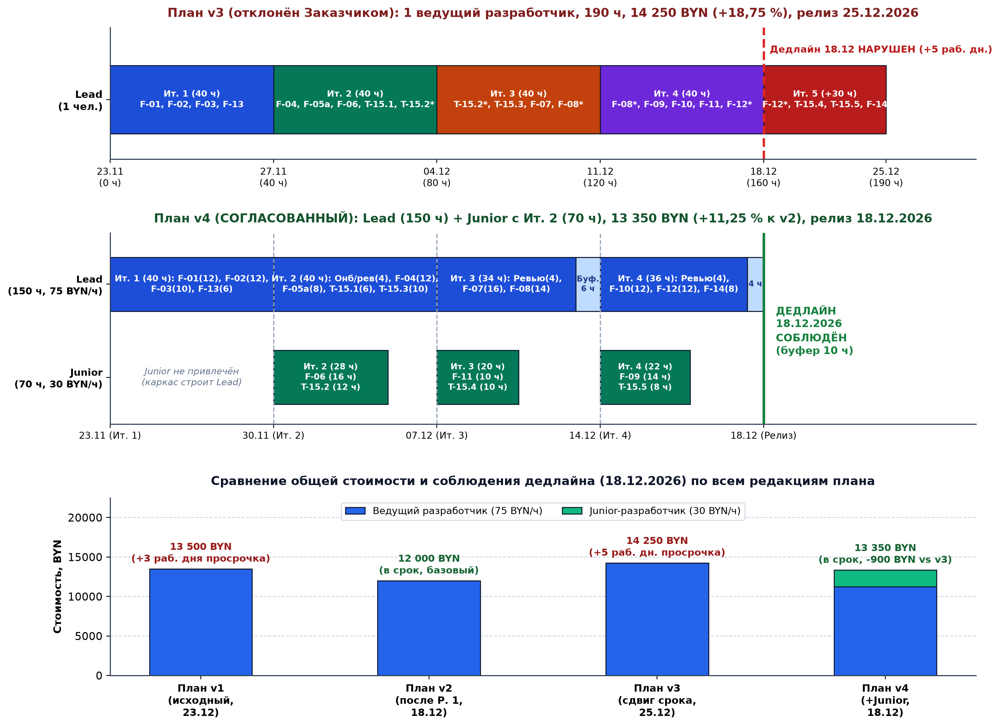

# Приоритизация функционала и планирование итераций — UAVLog 1.0

**Версия документа:** 3.0 (финальный согласованный план по итогам Раундов 1 и 2)  
**Дата:** 2026-11-19  
**Автор:** Осипенко О. С. (Архитектор системы / Ведущий разработчик)  
**Заказчик:** Мороз А. А. (Начальник службы эксплуатации БЛА)

---

## 1. Параметры планирования и ставки

- **Шкала приоритетов (Priority Scale):** от **10** (наивысший, критически важный) до **50** (минимальный).
- **Длина итерации:** 1 рабочая неделя = 5 рабочих дней = **40 чел.-ч** на одного разработчика.
- **Старт разработки:** 23.11.2026. **Фиксированный дедлайн (`CON-6`):** **18.12.2026** (4 итерации).
- **Ставки команды:**
  - Ведущий разработчик / Архитектор (Lead, Middle C++/Qt): **75 BYN/ч**;
  - Junior-разработчик (C++/Qt, привлекается с Итерации 2): **30 BYN/ч** (коэффициент производительности на типовых задачах ≈ 0.75; обязательное code review Lead — 12 ч за проект).

---

## 2. Эволюция функционального бэклога и приоритетов (v1 → v2 → v4)

| ID | Feature Name (English) | SRS Traceability | Dependencies | Priority (v1 → v2 → v4) | Effort Lead-eq (v1 → v2 → v4) | Исполнитель в Плане v4 |
|----|------------------------|------------------|--------------|-------------------------|-------------------------------|------------------------|
| F-01 | Core SQLite WAL Database Schema & App Bootstrap | REQ-INT-006, REQ-REL-001/003, REQ-INST-001, REQ-BUILD-001 | — | 10 → 10 → 10 | 12 → 12 → 12 ч | Lead (12 ч) |
| F-02 | User Authentication (PBKDF2), RBAC & Session Lock | REQ-FUNC-001, REQ-SEC-001..003, REQ-SEC-005 | F-01 | 10 → 10 → 10 | 14 → 12 → 12 ч | Lead (12 ч) |
| F-03 | UAV Types & Data-Driven Maintenance Regulations | REQ-FUNC-002, REQ-REUSE-001 | F-01, F-02 | 15 → 15 → 15 | 10 → 10 → 10 ч | Lead (10 ч) |
| F-04 | UAV Fleet Registry, Lifecycle States & Decommissioning | REQ-FUNC-003-2, REQ-FUNC-004-2, REQ-INT-001..003 | F-03 | 10 → 10 → 10 | 12 → 12 → 12 ч | Lead (12 ч) |
| F-05a | Battery (AKB) Registry & Cycle Limits Control | REQ-FUNC-004-2, REQ-FUNC-016 | F-04 | 25 → 35 → 20 | 8 → 8 → 8 ч | Lead (8 ч) |
| F-05b | Payload Assignment History Registry *(dropped in R2)* | REQ-FUNC-004 (отложено в v2.0) | F-04 | 25 → 35 → 50 (отлож.) | 8 → 8 → **0 ч** | Исключено (текст. поле в F-04) |
| F-06 | Operators Registry & Qualification Expiry Control | REQ-FUNC-005-2 | F-03 | 15 → 15 → 15 | 12 → 12 → 12 ч | Junior (**16 ч**) |
| F-07 | Flight Registration & 5-Factor Automated Admission Control | REQ-FUNC-006-3, REQ-INT-004, REQ-MAINT-001 | F-04, F-05a, F-06, T-15.3 | 10 → 10 → 10 | 16 → 16 → 16 ч | Lead (16 ч) |
| F-08 | Flight Hours, AKB Cycles & Maintenance Countdown Engine | REQ-FUNC-007, REQ-FUNC-008, REQ-PERF-001 | F-03, F-07 | 10 → 10 → 10 | 14 → 14 → 14 ч | Lead (14 ч) |
| F-09 | Proactive Alerts Dashboard (TO, Permits, AKB Thresholds) | REQ-FUNC-009-2, REQ-INT-003 | F-08 | 20 → 15 → 15 | 10 → 10 → 10 ч | Junior (**14 ч**) |
| F-10 | Maintenance Execution & Faults/Defects Management | REQ-FUNC-010, REQ-FUNC-011 | F-04, F-08 | 15 → 15 → 15 | 12 → 12 → 12 ч | Lead (12 ч) |
| F-11 | UAV Electronic Logbook (Formular) & Live Search/Filter | REQ-FUNC-012, REQ-FUNC-013, REQ-PERF-002 | F-04, F-06, F-07 | 20 → 25 → 25 | 12 → 8 → 8 ч | Junior (**10 ч**) |
| F-12 | Reporting Suite, CSV/PDF Export & A4 Printing | REQ-FUNC-014-2, REQ-INT-005/007, REQ-COMP-001, REQ-PERF-003 | F-08, F-10 | 25 → 15 → 15 | 20 → 12 → 12 ч | Lead (12 ч) |
| F-13 | Immutable Audit Trail (Table + CSV) & Error Log Rotation | REQ-SEC-004, REQ-OBS-001 | F-02 | 35 → 45 → 45 | 12 → 6 → 6 ч | Lead (6 ч) |
| F-14 | Backup/Restore, Portable ZIP Packaging & Acceptance QA | REQ-FUNC-015, REQ-REL-002, REQ-DIST-001, REQ-COMP-002, REQ-PERF-004 | Все модули | 30 → 30 → 30 | 8 → 8 → 8 ч | Lead (8 ч) |
| **F-15** | **Pre-flight Inspection Checklists & Fleet Readiness Act *(added in R2)*** | **REQ-FUNC-017, REQ-FUNC-006-3** | **F-01, F-03, F-04** | **— → — → 10** | **0 → 0 → 38 ч** | **Lead (16 ч) + Junior (30 ч)** |

### Декомпозиция нового модуля `F-15` (Раунд 2)

| Задача | Описание работ | Lead-эквивалент | Исполнитель в Плане v4 | Факт. часы |
|--------|----------------|-----------------|------------------------|------------|
| `T-15.1` | Схема БД SQLite (4 таблицы чек-листов и осмотров) и доменные сущности | 6 ч | Lead | 6 ч |
| `T-15.2` | Редактор шаблонов чек-листов по типам БЛА (CRUD в `F-03`) | 8 ч | Junior | 12 ч |
| `T-15.3` | Диалог предполётного осмотра и интеграция 5-го правила в `AdmissionService` | 10 ч | Lead | 10 ч |
| `T-15.4` | HTML/PDF-шаблон «Акта готовности парка к полётам» и печать A4 | 8 ч | Junior | 10 ч |
| `T-15.5` | Модульные и интеграционные тесты `F-15` (покрытие ≥ 80 %) | 6 ч | Junior | 8 ч |
| **Итого F-15** | **5 задач** | **38 ч** | **Lead + Junior** | **46 ч (16 L + 30 J)** |

---

## 3. План v3 (Раунд 2, 1 разработчик — отклонён Заказчиком)

При добавлении `F-15` (+38 ч) и исключении `F-05b` (-8 ч) объём работ составляет **190 ч** для одного разработчика:
- **Итерации 1–4 (23.11–18.12):** 160 ч;
- **Итерация 5 (21.12–25.12):** +30 ч (доработка `F-12`, `T-15.4`, `T-15.5`, `F-14`).
- **Дата релиза:** **25.12.2026** (срыв дедлайна `CON-6` на 5 рабочих дней);
- **Стоимость:** `190 ч × 75 BYN/ч` = **14 250 BYN** (+18.75 % к Плану v2).

---

## 4. План v4 (СОГЛАСОВАННЫЙ — Lead + Junior с Итерации 2, релиз 18.12.2026)

| Итерация | Даты | Задачи Lead (75 BYN/ч) | Часы Lead | Задачи Junior (30 BYN/ч) | Часы Junior | Итого стоимость итерации |
|----------|------|------------------------|-----------|--------------------------|-------------|--------------------------|
| **Итерация 1** | 23.11–27.11 | `F-01` (12 ч), `F-02` (12 ч), `F-03` (10 ч), `F-13` (6 ч) | **40 ч** | *(не привлечён — Lead готовит каркас и эталоны)* | **0 ч** | 3 000 BYN |
| **Итерация 2** | 30.11–04.12 | Онбординг/ревью (4 ч), `F-04` (12 ч), `F-05a` (8 ч), `T-15.1` (6 ч), `T-15.3` (10 ч) | **40 ч** | `F-06` (16 ч), `T-15.2` (12 ч) | **28 ч** | 3 840 BYN |
| **Итерация 3** | 07.12–11.12 | Код-ревью (4 ч), `F-07` (16 ч), `F-08` (14 ч) *(буфер 6 ч)* | **34 ч** | `F-11` (10 ч), `T-15.4` (10 ч) | **20 ч** | 3 150 BYN |
| **Итерация 4** | 14.12–18.12 | Код-ревью (4 ч), `F-10` (12 ч), `F-12` (12 ч), `F-14` (8 ч) *(буфер 4 ч)* | **36 ч** | `F-09` (14 ч), `T-15.5` (8 ч) | **22 ч** | 3 360 BYN |
| **ИТОГО** | **23.11–18.12** | **138 ч разр. + 12 ч ревью (буфер 10 ч)** | **150 ч** | **6 изолированных модулей (коэф. 0.74)** | **70 ч** | **13 350 BYN** |

---

## 5. Сводное сравнение всех редакций плана (v1, v2, v3, v4)

| Редакция плана | Команда | Объём (Lead-экв. / факт.) | Срок (нед.) | Дата релиза | Стоимость (BYN) | Откл. от Плана v2 | Статус дедлайна 18.12 |
|----------------|---------|---------------------------|-------------|-------------|-----------------|-------------------|-----------------------|
| **План v1** (исходный) | 1 Lead | 180 ч / 180 ч | 4.5 нед. (5 ит.) | 23.12.2026 | 13 500 | +1 500 (+12.5 %) | Нарушен (+3 раб. дня) |
| **План v2** (после Раунда 1) | 1 Lead | 160 ч / 160 ч | 4.0 нед. (4 ит.) | 18.12.2026 | 12 000 | Базовый (0 %) | Соблюдён |
| **План v3** (Раунд 2, сдвиг) | 1 Lead | 190 ч / 190 ч | 4.75 нед. (5 ит.) | 25.12.2026 | 14 250 | +2 250 (+18.75 %) | Нарушен (+5 раб. дней) |
| **План v4** (согласованный) | 1 Lead + 1 Junior | 190 ч / 220 ч (150 L + 70 J) | 4.0 нед. (4 ит.) | **18.12.2026** | **13 350** | **+1 350 (+11.25 %)** | **Соблюдён (буфер 10 ч)** |

