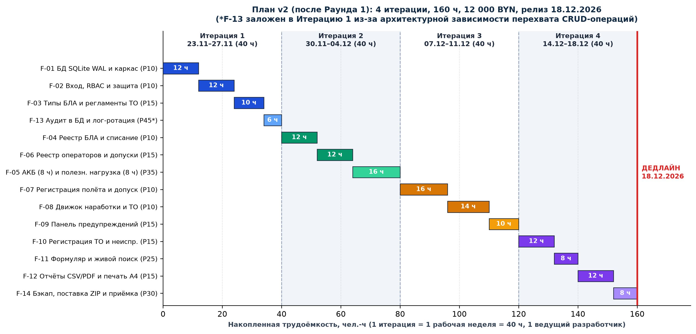

# Приоритизация функционала и планирование итераций — UAVLog 1.0

**Версия документа:** 2.0 (по итогам Раунда 1 обсуждения с Заказчиком)  
**Дата:** 2026-11-17  
**Автор:** Осипенко О. С. (Архитектор системы / Ведущий разработчик)  
**Заказчик:** Мороз А. А. (Начальник службы эксплуатации БЛА)

---

## 1. Правила приоритизации и расчёта стоимости

- **Шкала приоритетов (Priority Scale):** ранжирование от **10** (наивысший, критически важный) до **50** (минимальный). Наименования функциональных модулей приведены на английском языке.
- **Длина итерации:** 1 рабочая неделя (5 рабочих дней × 8 ч = **40 чел.-ч** на одного разработчика).
- **Старт разработки:** 23.11.2026. **Фиксированный дедлайн (CON-6):** 18.12.2026 (4 итерации = 160 ч).
- **Ставка Ведущего разработчика (Architect / Middle C++ Qt):** **75 BYN/ч**.

---

## 2. План v1 (исходный) и корректировки по итогам Раунда 1

Подробная переписка зафиксирована в [`correspondence-round1.md`](correspondence-round1.md). По итогам обсуждения скорректированы приоритеты Заказчика и применены 4 безопасные технические оптимизации (-20 ч):
- `F-12` (-8 ч): переход на HTML/CSS-шаблоны `QTextDocument` + `QPdfWriter` (ADR-0005);
- `F-13` (-6 ч): табличный просмотр `audit_log` + CSV вместо визуального diff-viewer (ADR-0003);
- `F-11` (-4 ч): переиспользуемый `QSortFilterProxyModel`;
- `F-02` (-2 ч): стандартный `QMessageAuthenticationCode` для PBKDF2.

| ID | Feature Name (English) | Dependencies | Priority v1 → v2 | Effort v1 → v2 (h) | Cost v2 (BYN) |
|----|------------------------|--------------|------------------|--------------------|---------------|
| F-01 | Core SQLite WAL Database Schema & App Bootstrap | — | 10 → 10 | 12 → 12 | 900 |
| F-02 | User Authentication (PBKDF2), RBAC & Session Lock | F-01 | 10 → 10 | 14 → 12 (-2) | 900 |
| F-03 | UAV Types & Data-Driven Maintenance Regulations | F-01, F-02 | 15 → 15 | 10 → 10 | 750 |
| F-04 | UAV Fleet Registry, Lifecycle States & Decommissioning | F-03 | 10 → 10 | 12 → 12 | 900 |
| F-05 | Battery (AKB) Cycle Tracking & Payload Assignment History | F-04 | 25 → 35 | 16 → 16 | 1 200 |
| F-06 | Operators Registry & Qualification Expiry Control | F-03 | 15 → 15 | 12 → 12 | 900 |
| F-07 | Flight Registration & Automated Admission Control | F-04, F-05, F-06 | 10 → 10 | 16 → 16 | 1 200 |
| F-08 | Flight Hours, AKB Cycles & Maintenance Countdown Engine | F-03, F-07 | 10 → 10 | 14 → 14 | 1 050 |
| F-09 | Proactive Alerts Dashboard (TO, Permits, AKB Thresholds) | F-08 | 20 → 15 | 10 → 10 | 750 |
| F-10 | Maintenance Execution & Faults/Defects Management | F-04, F-08 | 15 → 15 | 12 → 12 | 900 |
| F-11 | UAV Electronic Logbook (Formular) & Live Search/Filter | F-07, F-10 | 20 → 25 | 12 → 8 (-4) | 600 |
| F-12 | Reporting Suite, CSV/PDF Export & A4 Printing | F-08, F-10 | 25 → 15 | 20 → 12 (-8) | 900 |
| F-13 | Immutable Audit Trail (Table + CSV) & Error Log Rotation | F-02 | 35 → 45 | 12 → 6 (-6) | 450 |
| F-14 | Backup/Restore, Portable ZIP Packaging & Acceptance QA | F-01..F-13 | 30 → 30 | 8 → 8 | 600 |
| **ИТОГО** | **План v2 (после Раунда 1)** | — | **10–45** | **180 → 160 ч** | **12 000 BYN** |

---

## 3. План v2 — Итерационный план реализации (4 итерации × 40 ч = 160 ч)

| Итерация | Даты | Модули (ID, приоритет, зависимости) | Трудоёмкость | Стоимость | Инкремент для демонстрации Заказчику |
|----------|------|-------------------------------------|--------------|-----------|--------------------------------------|
| **Итерация 1** | 23.11–27.11.2026 | `F-01` (P10, 12 ч), `F-02` (P10, 12 ч), `F-03` (P15, 10 ч), `F-13` (P45*, 6 ч) | **40 ч** | 3 000 BYN | Каркас БД WAL, вход с RBAC и автоблокировкой, справочник типов БЛА и регламентов ТО, инфраструктура аудита |
| **Итерация 2** | 30.11–04.12.2026 | `F-04` (P10, 12 ч), `F-06` (P15, 12 ч), `F-05` (P35, 16 ч) | **40 ч** | 3 000 BYN | Главное окно парка, реестр бортов со списанием, реестр операторов с контролем сроков допуска, реестр АКБ и нагрузки |
| **Итерация 3** | 07.12–11.12.2026 | `F-07` (P10, 16 ч), `F-08` (P10, 14 ч), `F-09` (P15, 10 ч) | **40 ч** | 3 000 BYN | Регистрация полёта с 4-факторным контролем допуска, движок налёта и сроков ТО (unit-тесты ≥ 80 %), панель предупреждений |
| **Итерация 4** | 14.12–18.12.2026 | `F-10` (P15, 12 ч), `F-11` (P25, 8 ч), `F-12` (P15, 12 ч), `F-14` (P30, 8 ч) | **40 ч** | 3 000 BYN | Журналы ТО и неисправностей, формуляр и живой поиск, отчёты CSV/PDF A4, автобэкап, ZIP-поставка и приёмка |
| **ИТОГО** | **23.11–18.12.2026** | **Все 14 модулей** | **160 ч** | **12 000 BYN** | **Версия UAVLog 1.0 в срок (18.12.2026)** |

*\*Примечание: `F-13` включён в Итерацию 1 несмотря на приоритет 45 из-за сквозной технической зависимости (перехват CRUD-операций в сервисном слое), что исключает переделку всех сервисов в конце проекта.*

