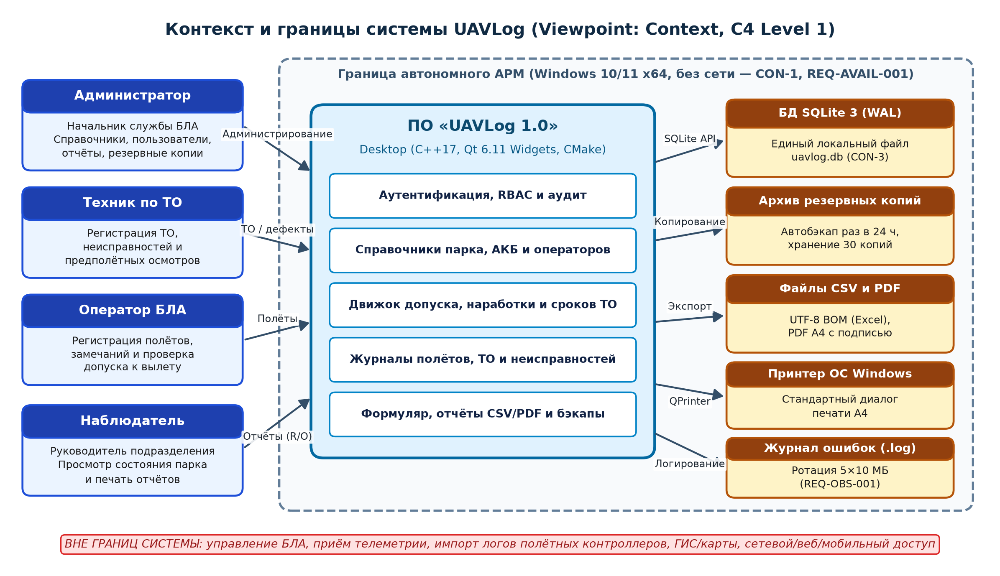
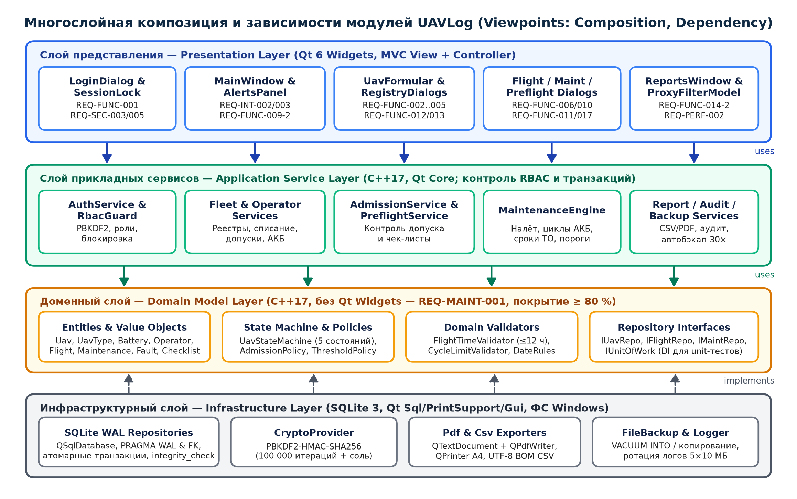
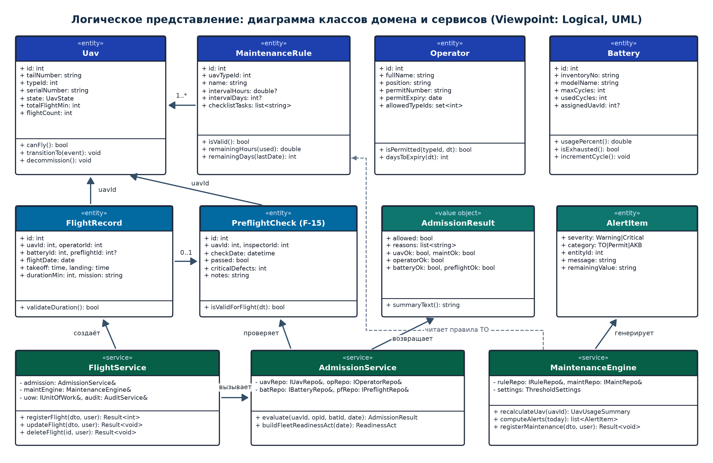
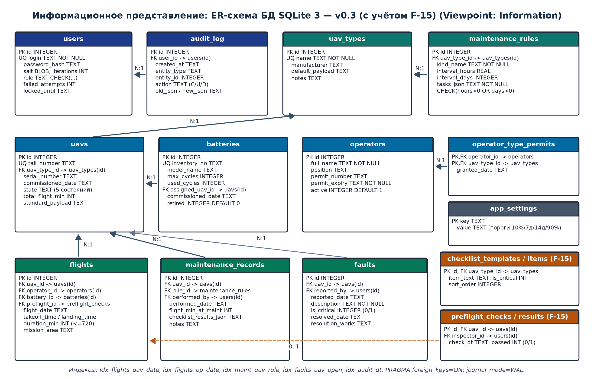
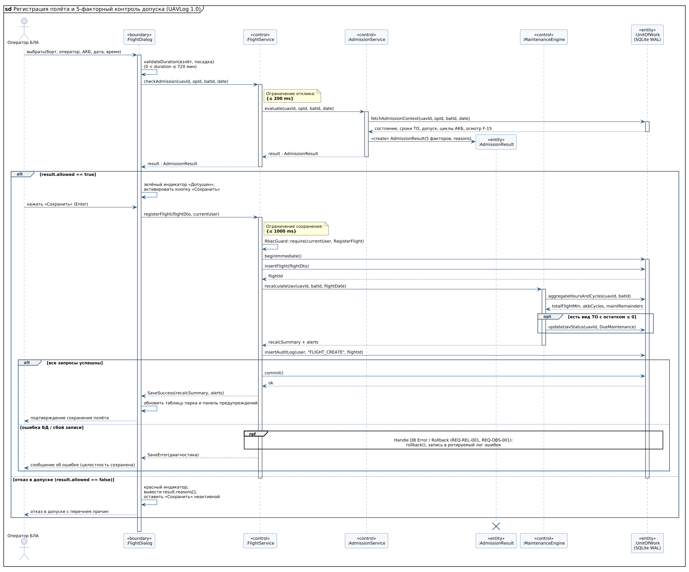
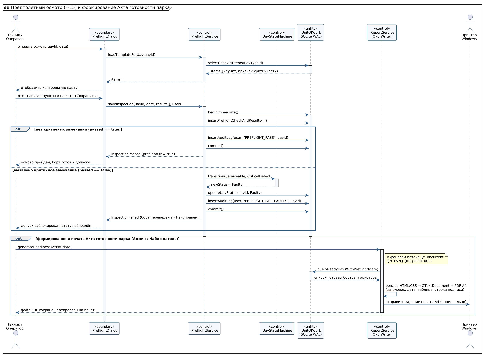
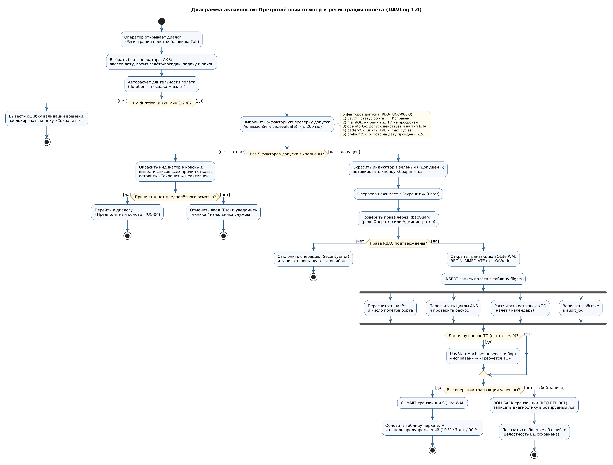
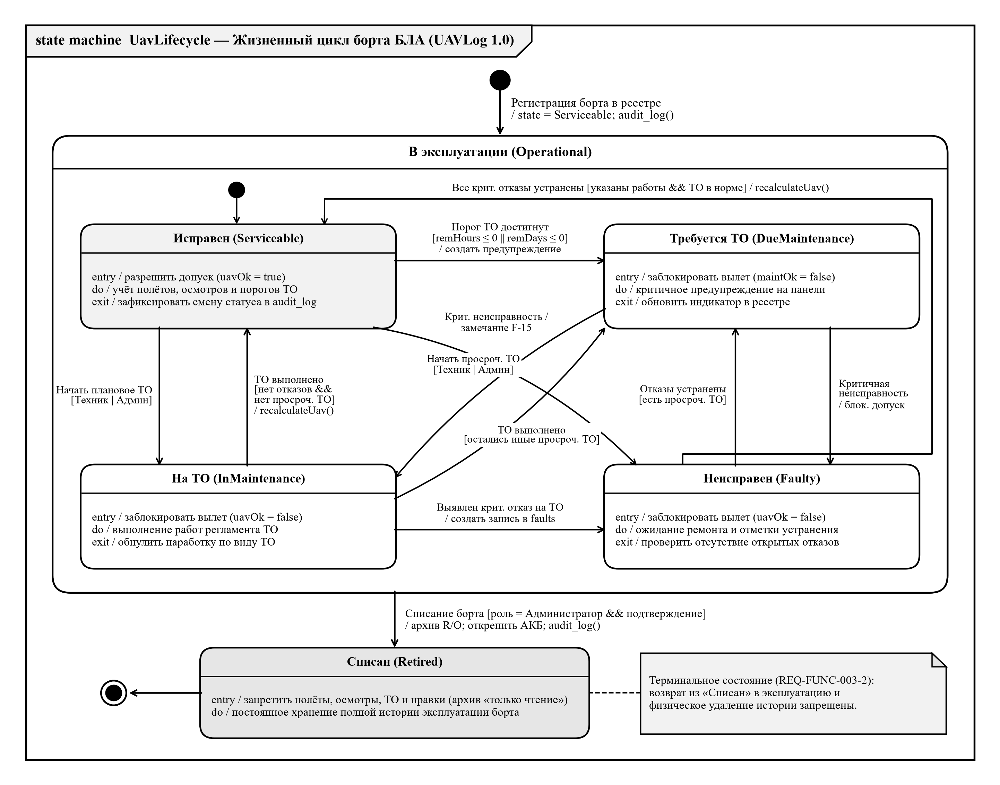
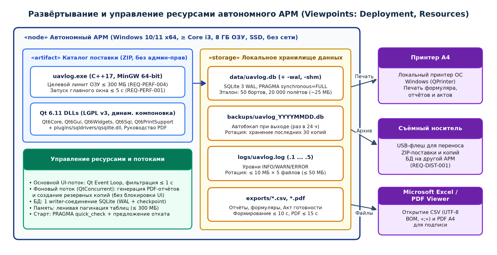
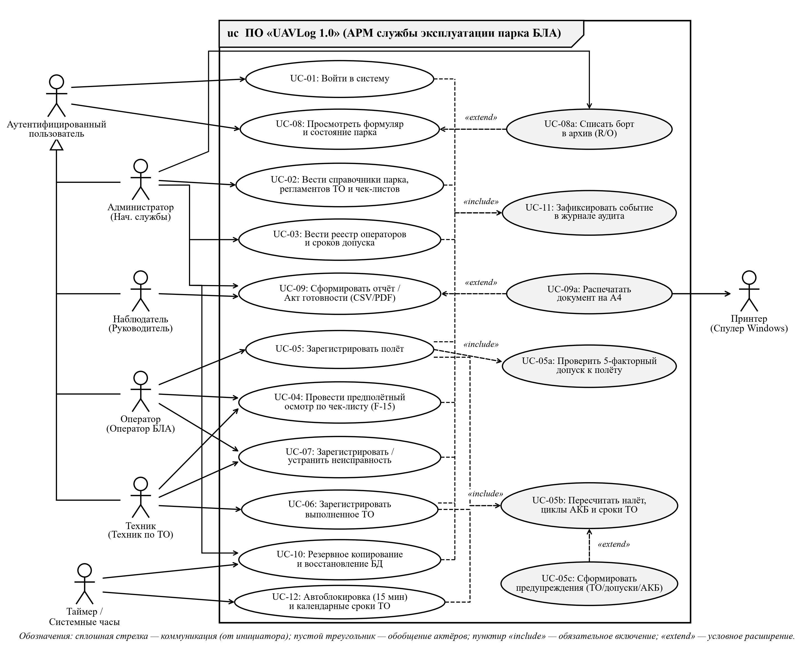

# Описание дизайна программного обеспечения

Для UAVLog — Журнал эксплуатации парка БЛА

Версия 0.4

Подготовил Осипенко О. С., гр. 434701 (Архитектор системы)

БГУИР, военный факультет, кафедра ЭВМ

2026-11-28

## Оглавление

<!-- TOC -->
* [1. Введение](#1-introduction)
  * [1.1 Назначение документа](#11-document-purpose)
  * [1.2 Область применения](#12-subject-scope)
  * [1.3 Определения, акронимы и сокращения](#13-definitions-acronyms-and-abbreviations)
  * [1.4 Ссылки](#14-references)
  * [1.5 Обзор документа](#15-document-overview)
* [2. Обзор дизайна](#2-design-overview)
  * [2.1 Задачи стейкхолдеров](#21-stakeholder-concerns)
  * [2.2 Выбранные точки зрения](#22-selected-viewpoints)
    * [2.2.1 Контекст](#221-context)
    * [2.2.2 Композиция](#222-composition)
    * [2.2.3 Логическое представление](#223-logical)
    * [2.2.4 Зависимости](#226-dependency)
    * [2.2.5 Информация](#227-information)
    * [2.2.6 Интерфейс](#228-interface)
    * [2.2.7 Взаимодействие](#229-interaction)
    * [2.2.8 Алгоритм](#2210-algorithm)
    * [2.2.9 Динамика состояний](#2211-state-dynamics)
    * [2.2.10 Паттерны](#2213-patterns)
    * [2.2.11 Развёртывание](#2214-deployment)
    * [2.2.12 Ресурсы](#2215-resources)
* [3. Проектные представления](#3-design-views)
* [4. Решения](#4-decisions)
* [5. Приложения](#5-appendixes)
<!-- TOC -->

## История изменений

| Name | Date | Reason For Changes | Version |
|------|------|--------------------|---------|
| Осипенко О. С. | 2026-11-16 | Первая редакция SDD на основе согласованного SRS v0.2, идентификация системных требований и выпуск ADR-0001…0005 | 0.1 |
| Осипенко О. С. | 2026-11-17 | Итоги Раунда 1 с Заказчиком: утверждён ADR-0005 (HTML/CSS через QTextDocument, -8 ч), упрощён GUI журнала аудита в ADR-0003 (-6 ч), унифицирован QSortFilterProxyModel (-4 ч), утверждён итерационный План v2 (160 ч) | 0.2 |
| Осипенко О. С. | 2026-11-19 | Итоги Раунда 2 с Заказчиком: исключён отдельный реестр перестановок полезной нагрузки (`F-05b`), добавлен модуль `F-15` (предполётные чек-листы и Акт готовности парка), обновлена ER-схема (`DV-04`), добавлен ADR-0006, утверждён План v4 с привлечением Junior-разработчика (релиз 18.12.2026, 13 350 BYN) | 0.3 |
| Осипенко О. С. | 2026-11-28 | Лабораторная работа №5: разработана полная модель динамического поведения UML 2.5 (`docs/uml/`: глоссарий, дополнительные спецификации, спецификация 7 актёров и 16 прецедентов, диаграммы Use-Case, Activity, State Machine и 2 Sequence в монохромной нотации СТП 01–2024); обновлены `DV-05`, `DV-06`, добавлено представление `DV-08`, выпущен `ADR-0007`; выполнена полная реализация приложения `project/UAVLog/` (12/12 CTest PASS) | 0.4 |

---

## 1. Введение {#1-introduction}

Документ описывает архитектуру, системные требования и детальный дизайн программного средства **UAVLog 1.0** — настольного приложения для учёта эксплуатации парка беспилотных летательных аппаратов (БЛА). В отличие от спецификации требований [SRS v0.3](../srs/srs-uavlog.md), отвечающей на вопрос **«что»** должна делать система, настоящий SDD фиксирует, **«как»** система устроена внутри, как декомпозирована на модули и классы и какими архитектурными решениями (ADR) обоснован каждый выбор.

### 1.1 Назначение документа {#11-document-purpose}

Настоящий SDD служит руководством к действию для команды разработчиков, архитектора и тестировщиков на этапах реализации, интеграции и сопровождения ПО UAVLog. Разработчики используют раздел 3 для реализации слоёв приложения, схемы БД и контрактов сервисов; тестировщики — для построения модульных и интеграционных тестов по матрице трассируемости; Заказчик и преподаватель — для проверки полноты покрытия требований SRS. Документ тесно связан со спецификацией [`srs/srs-uavlog.md`](../srs/srs-uavlog.md), протоколами решений [`docs/decisions/`](../docs/decisions/) и планом разработки [`docs/planning/prioritization-and-plan.md`](../docs/planning/prioritization-and-plan.md).

### 1.2 Область применения {#12-subject-scope}

Проектируемая система — **UAVLog версии 1.0**, автономное настольное приложение под Windows 10/11 x64 на языке C++17 с графическим интерфейсом Qt 6.11 (Qt Widgets) и встраиваемой СУБД SQLite 3. Продукт обеспечивает единый учёт парка БЛА, АКБ, полезной нагрузки и операторов (БЦ-1), достоверный расчёт налёта и циклов АКБ (БЦ-2), своевременное предупреждение о приближении ТО (БЦ-3), автоматическую блокировку вылета неисправного борта или оператора без допуска (БЦ-4) и формирование печатных/CSV/PDF отчётов за время менее 1 минуты (БЦ-5).

В область проектирования **входят**: многослойное настольное приложение, схема локальной БД SQLite 3 (режим WAL), подсистема аутентификации и RBAC, расчётный движок наработки и ТО, генератор отчётов CSV/PDF и механизм автоматического резервирования.

В область проектирования **не входят**: управление БЛА, приём телеметрии, импорт бинарных журналов полётных контроллеров, картографические/ГИС-функции, сетевая многопользовательская работа, веб- и мобильные клиенты (`CON-1`, `CON-2`).

### 1.3 Определения, акронимы и сокращения {#13-definitions-acronyms-and-abbreviations}

| Term | Definition |
|------|------------|
| ADR | Architecture Decision Record — протокол значимого архитектурного решения в формате MADR |
| ACID | Atomicity, Consistency, Isolation, Durability — свойства надёжных транзакций БД |
| DAO / Repository | Паттерн изоляции доступа к данным от доменной логики |
| DTO | Data Transfer Object — структура передачи данных между слоями Presentation и Services |
| FURPS+ | Модель классификации требований (Functionality, Usability, Reliability, Performance, Supportability + Constraints) |
| MVC | Model-View-Controller — паттерн отделения модели данных от графического интерфейса |
| PBKDF2 | Password-Based Key Derivation Function 2 — алгоритм хеширования паролей с солью |
| PlantUML | Текстовый DSL для декларативного описания диаграмм UML в подходе Docs-as-Code |
| RBAC | Role-Based Access Control — разграничение прав доступа на основе ролей пользователей |
| SDD | Software Design Description — описание проектирования ПО (IEEE 1016-2009) |
| SRS | Software Requirements Specification — спецификация требований к ПО (ISO/IEC/IEEE 29148) |
| UML 2.5 | Unified Modeling Language — унифицированный язык объектно-ориентированного моделирования (OMG) |
| UoW | Unit of Work — паттерн управления атомарной транзакцией нескольких репозиториев |
| WAL | Write-Ahead Logging — журнал упреждающей записи SQLite 3 для надёжности и скорости |
| АРМ | Автоматизированное рабочее место службы эксплуатации БЛА |
| БЛА / АКБ / ТО | Беспилотный летательный аппарат / Аккумуляторная батарея / Техническое обслуживание |

Полный проектный глоссарий (30 терминов с кодовыми соответствиями в БД SQLite и C++17) вынесен в отдельный файл [`docs/uml/glossary.md`](../docs/uml/glossary.md).

### 1.4 Ссылки {#14-references}

| Документ | Владелец, версия | Расположение | Статус |
|----------|------------------|--------------|--------|
| Спецификация требований UAVLog (SRS) | Осипенко О. С., v0.3 | [`srs/srs-uavlog.md`](../srs/srs-uavlog.md) | Нормативный |
| IEEE 1016-2009 Software Design Descriptions | IEEE, 2009 | ieeexplore.ieee.org | Справочный |
| ISO/IEC/IEEE 42010:2011 Architecture description | ISO/IEC/IEEE, 2011 | iso.org | Справочный |
| OMG Unified Modeling Language (OMG UML) 2.5.1 | OMG, 2017 | omg.org/spec/UML/2.5.1 | Справочный |
| Глоссарий проекта UAVLog (табличный) | Осипенко О. С., v1.0 | [`docs/uml/glossary.md`](../docs/uml/glossary.md) | Нормативный |
| Дополнительные спецификации (FURPS+ / BR) | Осипенко О. С., v1.0 | [`docs/uml/supplementary-specifications.md`](../docs/uml/supplementary-specifications.md) | Нормативный |
| Спецификация актёров и прецедентов (16 UC) | Осипенко О. С., v1.0 | [`docs/uml/use-case-specifications.md`](../docs/uml/use-case-specifications.md) | Нормативный |
| Текстовые модели UML 2.5 (PlantUML) и рендерер | Осипенко О. С., v1.0 | [`docs/uml/models/`](../docs/uml/models/), [`docs/uml/render_stp_diagrams.py`](../docs/uml/render_stp_diagrams.py) | Нормативный |
| Протоколы архитектурных решений (ADR-0001…0007) | Осипенко О. С., 2026 | [`docs/decisions/`](../docs/decisions/) | Нормативный |
| Приоритизация и план разработки по итерациям | Осипенко О. С., v3.0 | [`docs/planning/prioritization-and-plan.md`](../docs/planning/prioritization-and-plan.md) | Нормативный |
| Исходный код приложения UAVLog 1.0 и тесты CTest | Осипенко О. С., v1.0 | [`project/UAVLog/`](../project/UAVLog/) | Реализация |
| Справочник трассируемости и сравнения SRS/SDD | Кафедра ЭВМ БГУИР | [`docs/srs-vs-sdd.md`](../docs/srs-vs-sdd.md), [`docs/traceability.md`](../docs/traceability.md) | Справочный |

### 1.5 Обзор документа {#15-document-overview}

Раздел 2 определяет интересы стейкхолдеров и выбранные архитектурные точки зрения (ISO/IEC/IEEE 42010). Раздел 3 содержит конкретные проектные представления (`DV-01`…`DV-08`) с диаграммами статической структуры и динамического поведения UML 2.5, спецификациями интерфейсов и системными требованиями (`SYS-*`), трассируемыми к `REQ-*` и `UC-*`. Раздел 4 сводит принятые архитектурные решения (`ADR-0001`…`ADR-0007`) со ссылками на полные MADR-файлы. Раздел 5 содержит сводку системных требований и сквозную матрицу трассируемости от бизнес-целей до кода и модульных/интеграционных тестов. Изменения документа фиксируются в таблице «История изменений» по итогам каждого этапа проектирования.

---

## 2. Обзор дизайна {#2-design-overview}

### 2.1 Задачи стейкхолдеров {#21-stakeholder-concerns}

| Стейкхолдер | Ключевые задачи и риски (Concerns) | Адресующие точки зрения (Viewpoints) |
|-------------|------------------------------------|--------------------------------------|
| Начальник службы эксплуатации (Заказчик) | Исключение полётов неисправных бортов; соответствие форм отчётов A4/PDF; соблюдение дедлайна 18.12.2026 и бюджета | Context, Interaction, Information, Deployment |
| Операторы БЛА и техники по ТО | Быстрый ввод полётов с клавиатуры; понятные причины отказа в допуске; работа на полевом ноутбуке без сети | Context, Interaction, State Dynamics, Resources |
| Разработчики (Lead, возможный Junior) | Чёткое разделение слоёв; изоляция логики от Qt Widgets для unit-тестов (≥ 80 %); понятные контракты сервисов и схема БД | Composition, Logical, Dependency, Interface, Algorithm, Patterns |
| Тестировщик / Преподаватель | Полная трассируемость SRS → SDD → ADR; проверяемость NFR (≤ 5 с, ≤ 1 с, ≤ 15 с, ≤ 300 МБ); воспроизводимая сборка CMake | Information, Algorithm, Deployment, Resources |

### 2.2 Выбранные точки зрения {#22-selected-viewpoints}

Из 15 точек зрения стандарта ISO/IEC/IEEE 42010 / IEEE 1016 выбраны 12 релевантных для автономного настольного ПО UAVLog. Точки зрения **Physical** (аппаратная сеть/стойки), **Structure** (внутренние порты сложных распределённых узлов) и **Concurrency** (многопоточная синхронизация распределённых сервисов) не выделяются в отдельные диаграммы, так как ПО работает в одном процессе на одном АРМ (`CON-1`); вопросы фоновой генерации PDF и однопоточного доступа к SQLite WAL отражены в точке зрения **Resources / Deployment**.

#### 2.2.1 Контекст {#221-context}
**Адресует**: границы автономного АРМ, 4 роли пользователей, локальные хранилища и внешние устройства (принтер), явное исключение сетевых и телеметрийных функций (`DV-01`). **Язык**: контекстная диаграмма C4 Level 1.

#### 2.2.2 Композиция {#222-composition}
**Адресует**: четырёхслойную декомпозицию приложения на `Presentation`, `Application Services`, `Domain Model (uavlog_core)` и `Infrastructure` (`DV-02`). **Язык**: диаграмма компонентов / слоёв UML.

#### 2.2.3 Логическое представление {#223-logical}
**Адресует**: статическую структуру доменных классов, сущностей, объектов-значений и прикладных сервисов (`DV-03`). **Язык**: диаграмма классов UML.

#### 2.2.4 Зависимости {#226-dependency}
**Адресует**: направленность зависимостей между CMake-целями (`uavlog_ui` → `uavlog_services` → `uavlog_core` ← `uavlog_infra`), гарантирующую отсутствие ссылок ядра на `Qt6::Widgets` (`DV-02`). **Язык**: диаграмма пакетов и зависимостей.

#### 2.2.5 Информация {#227-information}
**Адресует**: реляционную схему БД SQLite 3, первичные и внешние ключи, ограничения `CHECK`/`UNIQUE` и составные индексы (`DV-04`). **Язык**: ER-диаграмма и SQL DDL.

#### 2.2.6 Интерфейс {#228-interface}
**Адресует**: C++-контракты прикладных сервисов и интерфейсов репозиториев (`IFlightService`, `IAdmissionService`, `IUnitOfWork`), отделяющие UI от хранения данных (`DV-03`, `DV-05`). **Язык**: сигнатуры классов C++17.

#### 2.2.7 Взаимодействие {#229-interaction}
**Адресует**: пошаговую последовательность вызовов во времени с контролем длительности для критичных сценариев: регистрация полёта с 5-факторным контролем допуска (`UC-05`, `UC-05a`, `UC-05b`, `UC-05c`) и предполётный осмотр `F-15` с формированием «Акта готовности парка» (`UC-04`, `UC-09`, `UC-09a`) (`DV-05`, `DV-08`). **Язык**: диаграммы вариантов использования и диаграммы последовательности UML 2.5 (PlantUML + монохромный рендеринг СТП 01–2024).

#### 2.2.8 Алгоритм {#2210-algorithm}
**Адресует**: поток управления (активности с дорожками ролей, параллелизмом `fork/join` и исключениями) и детерминированные алгоритмы расчёта налёта, остатков до ТО по налёту и календарю («что наступит раньше»), проверки 5 условий допуска (включая предполётный чек-лист `F-15`) и генерации предупреждений (`DV-06`). **Язык**: диаграмма активности UML 2.5, псевдокод и формулы.

#### 2.2.9 Динамика состояний {#2211-state-dynamics}
**Адресует**: конечный автомат жизненного цикла борта (`Serviceable`, `DueMaintenance`, `InMaintenance`, `Faulty`, `Retired`), составное активное состояние, действия `entry/do/exit` и сторожевые условия переходов (`DV-06`). **Язык**: диаграмма состояний UML 2.5, таблица переходов и ссылка на модель SysML v2.

#### 2.2.10 Паттерны {#2213-patterns}
**Адресует**: согласованное применение паттернов MVC, Service Layer, Repository, Unit of Work, Policy/Strategy и State Machine (`DV-02`, `DV-06`). **Язык**: каталог применённых паттернов.

#### 2.2.11 Развёртывание {#2214-deployment}
**Адресует**: состав портативной ZIP-поставки под Windows 10/11 x64 без прав администратора, структуру каталогов `data/`, `backups/`, `logs/`, `exports/` (`DV-07`). **Язык**: диаграмма развёртывания UML.

#### 2.2.12 Ресурсы {#2215-resources}
**Адресует**: бюджет ОЗУ (≤ 300 МБ), время отклика (≤ 1 с / ≤ 5 с / ≤ 15 с), ротацию 30 бэкапов и 5×10 МБ логов, вынос тяжёлых PDF-задач в `QtConcurrent` (`DV-07`). **Язык**: диаграмма и таблица бюджетов ресурсов.

---

## 3. Проектные представления {#3-design-views}

### DV-01 — Контекст и границы системы
- **ID**: `DV-01-context`
- **Title**: Системный контекст и границы автономного АРМ UAVLog
- **Viewpoint**: Context
- **Representation**:

Система функционирует строго в границах одного автономного АРМ без сетевых интерфейсов. Взаимодействие с окружением ограничено четырьмя ролями пользователей (через Qt GUI), локальной файловой системой Windows (БД SQLite, архивы резервных копий, файлы отчётов CSV/PDF, лог-файлы) и системным спулером печати A4.



- **More Information**: Реализует `CON-1`, `CON-2`, `CON-3`, `REQ-AVAIL-001`, `REQ-INT-005`, `REQ-INT-006`, `REQ-INT-007`. Расширяет модель контекста [`srs/models/01-context.sysml`](../srs/models/01-context.sysml).

---

### DV-02 — Многослойная композиция и граф зависимостей
- **ID**: `DV-02-composition`
- **Title**: Четырёхслойная архитектура и зависимости CMake-модулей
- **Viewpoint**: Composition, Dependency
- **Representation**:

Приложение разделено на четыре горизонтальных слоя с однонаправленными зависимостями сверху вниз (с инверсией зависимостей для репозиториев в слое инфраструктуры):
1. **Presentation Layer (`uavlog_ui`)** — окна и диалоги Qt 6 Widgets, модели-представления `QAbstractTableModel` и прокси-фильтрация `QSortFilterProxyModel`. Не содержит SQL и формул расчёта.
2. **Application Service Layer (`uavlog_services`)** — прикладные сервисы (`AuthService`, `FleetService`, `FlightService`, `AdmissionService`, `MaintenanceEngine`, `ReportService`, `AuditService`, `BackupService`). Выполняет проверку RBAC (`RbacGuard`), управление транзакциями `IUnitOfWork` и фиксацию аудита.
3. **Domain Model Layer (`uavlog_core`)** — чистый C++17 без зависимостей от `Qt6::Widgets` и `Qt6::Sql`: сущности, валидаторы, конечный автомат борта, политики допуска и абстрактные интерфейсы репозиториев.
4. **Infrastructure Layer (`uavlog_infra`)** — реализации SQLite-репозиториев, `CryptoProvider` (PBKDF2-HMAC-SHA256), экспортёры `PdfExporter` / `CsvExporter`, сервис копирования БД и ротатор лог-файлов.



- **More Information**: Обосновано в [ADR-0001](../docs/decisions/0001-layered-mvc-architecture.md) и [ADR-0002](../docs/decisions/0002-sqlite-wal-and-repository-pattern.md). Реализует `REQ-MAINT-001`, `REQ-SEC-002`, `REQ-PORT-001`, `REQ-BUILD-001`.

---

### DV-03 — Логическая модель классов и программные интерфейсы
- **ID**: `DV-03-logical`
- **Title**: Диаграмма классов доменного и сервисного слоёв
- **Viewpoint**: Logical, Interface
- **Representation**:

Ключевые абстракции домена и контракты сервисов приведены на диаграмме классов. Имена сущностей унифицированы с таблицами БД (`DV-04`).



Ключевые C++-контракты (Interface Viewpoint):
```cpp
struct AdmissionResult {
    bool allowed = false;
    bool uavOk = false, maintOk = false, operatorOk = false, batteryOk = false, preflightOk = false;
    std::vector<std::string> reasons;
};

class IAdmissionService {
public:
    virtual ~IAdmissionService() = default;
    virtual AdmissionResult evaluate(int uavId, int operatorId,
                                     int batteryId, const std::string& flightDateIso) const = 0;
};

class IUnitOfWork {
public:
    virtual ~IUnitOfWork() = default;
    virtual void beginImmediate() = 0;
    virtual void commit() = 0;
    virtual void rollback() noexcept = 0;
};
```

- **More Information**: Обосновано в [ADR-0001](../docs/decisions/0001-layered-mvc-architecture.md), [ADR-0004](../docs/decisions/0004-data-driven-maintenance-rules-engine.md). Реализует `REQ-FUNC-002…011`, `REQ-FUNC-016`, `REQ-MAINT-001`.

---

### DV-04 — Информационное представление (ER-схема БД SQLite 3)
- **ID**: `DV-04-information`
- **Title**: Реляционная схема базы данных SQLite 3 и индексирование
- **Viewpoint**: Information
- **Representation**:

Все данные хранятся в одном файле `uavlog.db` с включёнными `PRAGMA foreign_keys = ON`, `PRAGMA journal_mode = WAL`, `PRAGMA synchronous = FULL`. Версия схемы хранится в `PRAGMA user_version` для автоматических миграций. Для соблюдения `REQ-PERF-001…003` на эталонной БД (50 бортов, 20 000 полётов) создаются составные индексы:
- `idx_flights_uav_date(uav_id, flight_date DESC)` — быстрый пересчёт налёта и формуляра борта;
- `idx_flights_op_date(operator_id, flight_date DESC)` — отчёт «Налёт по операторам» и фильтрация;
- `idx_maint_uav_rule(uav_id, rule_id, performed_date DESC)` — поиск последнего выполненного ТО;
- `idx_faults_uav_open(uav_id, is_critical, resolved_date)` — мгновенная проверка открытых критичных отказов;
- `idx_audit_dt(created_at DESC)` — просмотр и экспорт журнала аудита.



- **More Information**: Обосновано в [ADR-0002](../docs/decisions/0002-sqlite-wal-and-repository-pattern.md) и [ADR-0003](../docs/decisions/0003-pbkdf2-rbac-and-audit-trail.md). Реализует `CON-3`, `REQ-INT-006`, `REQ-FUNC-002…016`, `REQ-SEC-001`, `REQ-SEC-004`, `REQ-REL-001`.

---

### DV-05 — Взаимодействие при регистрации полёта, осмотре F-15 и формировании Акта (UML 2.5)
- **ID**: `DV-05-interaction`
- **Title**: Диаграммы последовательности UML 2.5 критичных динамических сценариев
- **Viewpoint**: Interaction
- **Representation**:

В редакции v0.4 взаимодействие в рантайме детализировано двумя диаграммами последовательности в полной нотации UML 2.5 (рамка `sd`, стереотипированные линии жизни `«actor»` / `«boundary»` / `«control»` / `«entity»`, синхронные вызовы, пунктирные возвраты, асинхронные сигналы Qt, создание объекта `«create»`, уничтожение объекта `X`, спецификации выполнения, временны́е ограничения `{≤ 200 мс}`, `{≤ 1000 мс}`, `{≤ 15 с}`, комбинированные фрагменты `alt` / `opt` и ссылка на фрагмент взаимодействия `ref`).

**1) Сценарий `UC-05` — Регистрация полёта с 5-факторным контролем допуска и пересчётом ТО:**
При изменении борта, оператора, АКБ или даты в `FlightDialog` (`«boundary»`) синхронно вызывается `AdmissionService::evaluate(...)` (`«control»`), возвращающий структуру `AdmissionResult` за `{≤ 200 мс}`. При нажатии «Сохранить» (ветка `alt [allowed == true]`) `FlightService` создаёт временный объект транзакции `«create» UnitOfWork (BEGIN IMMEDIATE)`, сохраняет запись полёта, выполняет полный детерминированный пересчёт `SUM`/`COUNT` в `MaintenanceEngine`, при достижении порога переводит борт в `DueMaintenance`, фиксирует запись в `audit_log`, выполняет `COMMIT` и уничтожает объект транзакции (`X`) в пределах `{≤ 1000 мс}`. При сбое СУБД вызывается повторно используемый фрагмент `ref [Откат транзакции и запись в uavlog.log]`. В ветке `[else]` кнопка сохранения блокируется и пользователю отображается перечень причин отказа (с кнопкой быстрого перехода к `UC-04`).



**2) Сценарий `UC-04` + `UC-09` — Предполётный осмотр (`F-15`) и печать «Акта готовности парка к полётам»:**
Техник или оператор заполняет контрольную карту в `PreflightDialog`. При отсутствии критичных замечаний `PreflightService` сохраняет осмотр со статусом `passed = true` и открывает 5-й фактор допуска. При наличии критичного замечания (ветка `alt`) вызывается `UavStateMachine::transition(..., CriticalFaultReported)`, переводящая борт в `Faulty`, и опционально (`opt`) создаётся запись критичной неисправности в `faults`. На этапе формирования отчётности `ReportService` агрегирует статусы парка и осмотров на дату, `PdfExporter` генерирует HTML/CSS → A4 PDF (`QTextDocument` + `QPdfWriter`) за `{≤ 15 с}` и опционально (`opt`) передаёт задание в системный спулер печати Windows (`QPrinter`).



- **More Information**: Исходные текстовые модели: [`docs/uml/models/04-sequence-flight-registration.puml`](../docs/uml/models/04-sequence-flight-registration.puml), [`docs/uml/models/05-sequence-preflight-and-readiness.puml`](../docs/uml/models/05-sequence-preflight-and-readiness.puml). Обосновано в [ADR-0002](../docs/decisions/0002-sqlite-wal-and-repository-pattern.md), [ADR-0003](../docs/decisions/0003-pbkdf2-rbac-and-audit-trail.md), [ADR-0004](../docs/decisions/0004-data-driven-maintenance-rules-engine.md), [ADR-0006](../docs/decisions/0006-preflight-checklists-and-team-scaling.md), [ADR-0007](../docs/decisions/0007-uml-dynamic-behavior-modeling.md). Реализует `REQ-FUNC-006-3`, `REQ-FUNC-007`, `REQ-FUNC-008`, `REQ-FUNC-017`, `REQ-PERF-002`, `REQ-PERF-003`, `REQ-REL-001`, `REQ-SEC-004`.

---

### DV-06 — Поток управления, алгоритмы расчёта, динамика состояний и паттерны (UML 2.5)
- **ID**: `DV-06-algorithms-states`
- **Title**: Диаграмма активности, алгоритм расчёта ТО и конечный автомат состояний борта
- **Viewpoint**: Algorithm, State Dynamics, Patterns
- **Representation**:

**1) Диаграмма активности регистрации полёта (`UC-05`, UML 2.5):**
Поток управления декомпозирован на четыре дорожки ответственности (`Оператор БЛА`, `FlightDialog (UI)`, `FlightService / AdmissionService`, `SQLite 3 (WAL)`) с явным отображением узлов ветвления/слияния (проверка длительности `0 < Δt ≤ 12 ч`, 5-факторная проверка допуска), параллельной барьерной секции `fork / join` (пересчёт налёта, циклов АКБ и остатков ТО по всем регламентам) и потока исключения `ROLLBACK` при сбое записи.



**2) Алгоритм расчёта остатка до ТО (`MaintenanceEngine::recalculateUav`, `src/core/MaintenanceEngine.cpp`)**:
Для каждого регламента `r` из `maintenance_rules` по типу борта:
```text
lastMaint = MAX(performed_date, flight_min_at_maint) по (uav_id, r.id)
usedHours = (uav.total_flight_min - lastMaint.flight_min_at_maint) / 60.0
remHours  = r.interval_hours - usedHours             // если задана периодичность по налёту
remDays   = (lastMaint.date + r.interval_days) - today // если задана по календарю
isOverdue = (remHours <= 0) OR (remDays <= 0)
isWarning = (remHours <= (settings.warn_pct_to / 100.0) * r.interval_hours)
            OR (remDays <= settings.warn_days_to)
```
Борт автоматически переходит в `DueMaintenance`, если `isOverdue == true` хотя бы для одного вида ТО.

**3) Диаграмма состояний жизненного цикла борта (`UavStateMachine`, UML 2.5):**
Конечный автомат выделяет составное состояние `В эксплуатации` (содержащее `Исправен`, `Требуется ТО`, `На ТО`, `Неисправен`) и терминальное состояние `Списан (Retired)`. Для каждого состояния определены внутренние действия `entry` / `do` / `exit`, а переходы снабжены событиями, сторожевыми условиями `[...]` и эффектами `/ ...`.



**Таблица переходов состояний (`src/core/UavStateMachine.cpp`, синхронизирована с [`srs/models/04-uav-states.sysml`](../srs/models/04-uav-states.sysml))**:

| Текущее состояние | Событие / сторожевое условие | Новое состояние | Допуск к полёту |
|-------------------|------------------------------|-----------------|-----------------|
| `Serviceable` | Порог ТО достигнут (`MaintenanceOverdue [isOverdue]`) | `DueMaintenance` | Запрещён |
| `Serviceable` / `DueMaintenance` | Начало работ ТО (`StartMaintenance [Техник/Админ]`) | `InMaintenance` | Запрещён |
| `InMaintenance` | Регистрация выполненного ТО (`CompleteMaintenance [!hasOpenCritFaults && !isOverdue]`) | `Serviceable` | Разрешён |
| `InMaintenance` | Выполнено ТО при открытой критичной неисправности (`[!hasOpenCritFaults == false]`) | `Faulty` | Запрещён |
| `Serviceable` / `DueMaintenance` / `InMaintenance` | Критичная неисправность или провал чек-листа `F-15` (`CriticalFaultReported`) | `Faulty` | Запрещён |
| `Faulty` | Устранение всех критичных отказов (`AllCriticalFaultsResolved [!isOverdue]`) | `Serviceable` | Разрешён |
| `Faulty` | Устранение отказов при просроченном ТО (`AllCriticalFaultsResolved [isOverdue]`) | `DueMaintenance` | Запрещён |
| `В эксплуатации` (любое подсостояние) | Списание администратором (`Decommission [Админ && причина != ""]`) | `Retired` (терминальное) | Запрещён навсегда (R/O) |

**4) Каталог паттернов**: MVC (активная модель), Service Layer, Repository + Unit of Work, State Machine, Strategy/Policy (правила допуска и порогов из БД), Proxy (`QSortFilterProxyModel`).

- **More Information**: Исходные модели: [`docs/uml/models/02-activity-flight-registration.puml`](../docs/uml/models/02-activity-flight-registration.puml), [`docs/uml/models/03-state-uav-lifecycle.puml`](../docs/uml/models/03-state-uav-lifecycle.puml). Обосновано в [ADR-0001](../docs/decisions/0001-layered-mvc-architecture.md), [ADR-0004](../docs/decisions/0004-data-driven-maintenance-rules-engine.md), [ADR-0007](../docs/decisions/0007-uml-dynamic-behavior-modeling.md). Реализует `REQ-FUNC-003-2`, `REQ-FUNC-006-3`, `REQ-FUNC-007`, `REQ-FUNC-008`, `REQ-FUNC-009-2`, `REQ-FUNC-010`, `REQ-FUNC-011`, `REQ-REUSE-001`.

---

### DV-07 — Развёртывание и управление ресурсами АРМ
- **ID**: `DV-07-deployment-resources`
- **Title**: Портативное развёртывание Windows x64 и бюджеты системных ресурсов
- **Viewpoint**: Deployment, Resources
- **Representation**:

Поставка представляет собой портативный ZIP-архив (`uavlog.exe`, динамические библиотеки Qt 6.11 по LGPL v3, драйвер `qsqlite.dll`, руководство пользователя PDF и файл лицензий), распаковываемый в любой каталог пользователя без прав администратора (`REQ-INST-001`, `REQ-DIST-001`).



Бюджет ресурсов:
- **ОЗУ**: целевое потребление ≤ 150 МБ, жёсткий предел ≤ 300 МБ (`REQ-PERF-004`) за счёт потоковой записи CSV и постраничного чтения `LIMIT/OFFSET` в крупных журналах;
- **Диск**: БД на 20 000 полётов ~25 МБ; 30 автобэкапов ~750 МБ (ротация FIFO по дате); логи ≤ 50 МБ (5 файлов × 10 МБ);
- **Отзывчивость UI**: генерация годовых отчётов и `VACUUM INTO`-бэкапов выполняется в фоновом потоке (`QtConcurrent`) с отображением прогресса.

- **More Information**: Обосновано в [ADR-0002](../docs/decisions/0002-sqlite-wal-and-repository-pattern.md) и [ADR-0005](../docs/decisions/0005-native-qt-pdf-and-csv-reporting.md). Реализует `REQ-PERF-001…004`, `REQ-REL-002`, `REQ-REL-003`, `REQ-OBS-001`, `REQ-INST-001`, `REQ-DIST-001`, `REQ-COMP-002`.

---

### DV-08 — Модель вариантов использования и динамическая спецификация (UML 2.5)
- **ID**: `DV-08-use-cases`
- **Title**: Диаграмма вариантов использования, роли актёров и внешние спецификации UML
- **Viewpoint**: Context, Interaction
- **Representation**:

Функциональные границы системы и распределение обязанностей ролей зафиксированы на диаграмме вариантов использования UML 2.5, охватывающей **7 актёров** (обобщённый `Аутентифицированный пользователь`, 4 пользовательские роли RBAC `Администратор`, `Техник`, `Оператор`, `Наблюдатель`, системный актёр `Таймер / Системные часы` и вторичный актёр `Принтер (Спулер Windows)`) и **16 вариантов использования** (`UC-01`…`UC-12`, `UC-05a/b/c`, `UC-08a`, `UC-09a`).

Отношения на диаграмме строго соответствуют семантике UML 2.5:
- **Обобщение (`generalization`)** — единственно допустимая связь между актёрами: 4 роли RBAC наследуют базовые прецеденты входа (`UC-01`) и просмотра формуляров (`UC-08`) от `Аутентифицированный пользователь`;
- **Ассоциация (communication)** — инициирующее или ответное взаимодействие актёра с прецедентом;
- **Включение (`«include»`)** — обязательное выполнение подпроцесса в каждом запуске базового прецедента: 5-факторная проверка допуска (`UC-05` → `UC-05a`) и запись в журнал аудита (`UC-01…07, 10` → `UC-11`);
- **Расширение (`«extend»`)** — условное ветвление в точках расширения: блокировка вылета (`UC-05b`), автоматический переход в «Требуется ТО» (`UC-05c`), списание борта в архив (`UC-08a`) и печать на системный принтер A4 (`UC-09a`).



Вспомогательные артефакты моделирования вынесены в отдельные нормативные файлы в каталоге [`docs/uml/`](../docs/uml/):
1. **Глоссарий проекта (табличный, 30 терминов):** [`docs/uml/glossary.md`](../docs/uml/glossary.md) — обеспечивает единый язык предметной области (Ubiquitous Language) между SRS, UML-диаграммами, таблицами SQLite и классами C++17;
2. **Дополнительные спецификации (FURPS+ и бизнес-правила `BR-01`…`BR-08`):** [`docs/uml/supplementary-specifications.md`](../docs/uml/supplementary-specifications.md) — фиксирует сквозные нефункциональные ограничения, не принадлежащие единственному прецеденту;
3. **Полная спецификация актёров и 16 прецедентов:** [`docs/uml/use-case-specifications.md`](../docs/uml/use-case-specifications.md) — для каждого актёра приведено 1–2-строчное описание роли, для каждого прецедента — пояснение, предусловия, основной/альтернативные потоки, потоки ошибок и постусловия.

- **More Information**: Исходная модель [`docs/uml/models/01-use-case.puml`](../docs/uml/models/01-use-case.puml), рендерер [`docs/uml/render_stp_diagrams.py`](../docs/uml/render_stp_diagrams.py). Обосновано в [ADR-0007](../docs/decisions/0007-uml-dynamic-behavior-modeling.md). Реализует все функциональные и ролевые требования `REQ-FUNC-001…017`, `REQ-SEC-001…005`.

---

## 4. Решения {#4-decisions}

Полные протоколы решений оформлены по шаблону MADR в каталоге [`docs/decisions/`](../docs/decisions/).

- **ID**: `ADR-0001`
- **Title**: Многослойная архитектура MVC с выделенным сервисным и доменным слоями
- **Context**: Требуется изолировать бизнес-логику от Qt Widgets (`REQ-MAINT-001`) и централизовать RBAC (`REQ-SEC-002`).
- **Options**: Четырёхслойная MVC+Services+Domain+Infra; Smart UI; Плагинная микроядерная архитектура.
- **Outcome**: Выбран вариант **«Четырёхслойная архитектура»**, так как обеспечивает unit-тестируемость ≥ 80 % без GUI и чистые границы модулей.
- **More Information**: [`docs/decisions/0001-layered-mvc-architecture.md`](../docs/decisions/0001-layered-mvc-architecture.md)

- **ID**: `ADR-0002`
- **Title**: Хранение данных в SQLite 3 (режим WAL), паттерн Repository и Unit of Work
- **Context**: Требуется однофайловая локальная БД (`CON-3`) с ACID-устойчивостью при отключении питания (`REQ-REL-001`) и быстрой фильтрацией (`REQ-PERF-002`).
- **Options**: SQLite WAL + Repository/UoW; SQLite DELETE + QSqlTableModel; Файлы JSON/XML.
- **Outcome**: Выбран вариант **«SQLite 3 (WAL + FULL) + Repository/UoW»**, так как гарантирует атомарность, целостность и горячие бэкапы `VACUUM INTO`.
- **More Information**: [`docs/decisions/0002-sqlite-wal-and-repository-pattern.md`](../docs/decisions/0002-sqlite-wal-and-repository-pattern.md)

- **ID**: `ADR-0003`
- **Title**: Аутентификация PBKDF2-HMAC-SHA256, ролевая модель RBAC и журнал аудита
- **Context**: Требуется хеширование паролей PBKDF2 (`REQ-SEC-001`), RBAC на уровне данных (`REQ-SEC-002`), автоблокировка 15 мин (`REQ-SEC-003`), аудит (`REQ-SEC-004`) без платных/тяжёлых библиотек.
- **Options**: Встроенная реализация на Qt Core + `RbacGuard` + SQLite `audit_log`; OpenSSL/libsodium; Проверки только в GUI.
- **Outcome**: Выбран вариант **«Встроенный PBKDF2 + `RbacGuard` + SQLite `audit_log`»**, так как соответствует `REQ-SEC-001…005` без внешних сборочных зависимостей.
- **More Information**: [`docs/decisions/0003-pbkdf2-rbac-and-audit-trail.md`](../docs/decisions/0003-pbkdf2-rbac-and-audit-trail.md)

- **ID**: `ADR-0004`
- **Title**: Таблично-управляемый движок расчёта наработки, сроков ТО и предупреждений
- **Context**: Регламенты ТО и пороги предупреждений должны задаваться данными без пересборки (`REQ-REUSE-001`) с точным пересчётом при правке истории (`REQ-FUNC-007`).
- **Options**: Таблично-управляемый `MaintenanceEngine` + транзакционный пересчёт; Инкрементальная дельта; Пересчёт на лету без кеширования.
- **Outcome**: Выбран вариант **«Таблично-управляемый `MaintenanceEngine`»**, так как исключает рассинхронизацию и укладывается в `< 1 с`.
- **More Information**: [`docs/decisions/0004-data-driven-maintenance-rules-engine.md`](../docs/decisions/0004-data-driven-maintenance-rules-engine.md)

- **ID**: `ADR-0005`
- **Title**: Формирование отчётов, экспорт в CSV/PDF и печать средствами Qt
- **Context**: Требуются 4 отчёта, формуляр A4, CSV (UTF-8 BOM, `;`) и PDF за ≤ 15 с на бесплатном стеке (`CON-5`).
- **Options**: Отрисовка `QPainter` (20 ч); HTML/CSS-шаблоны `QTextDocument` + `QPdfWriter` (12 ч); Внешний генератор отчётов.
- **Outcome**: Выбран вариант **«HTML/CSS-шаблоны `QTextDocument` + `QPdfWriter`»** (утверждено в Раунде 1, 17.11.2026, `status: accepted`), экономия 8 ч без потери качества A4/PDF.
- **More Information**: [`docs/decisions/0005-native-qt-pdf-and-csv-reporting.md`](../docs/decisions/0005-native-qt-pdf-and-csv-reporting.md)

- **ID**: `ADR-0006`
- **Title**: Архитектура предполётного осмотра (F-15) и масштабирование команды с привлечением Junior-разработчика
- **Context**: В Раунде 2 исключён отдельный реестр полезной нагрузки (`F-05b`, -8 ч) и добавлен критичный модуль `F-15` (+38 ч) при жёстком дедлайне 18.12.2026 и лимите роста бюджета ≤ 12 %.
- **Options**: Привлечение Junior-разработчика со 2-й итерации (План v4, 13 350 BYN, 18.12); Один Lead со сдвигом срока (План v3, 14 250 BYN, 25.12); Второй Middle/Lead (15 000+ BYN).
- **Outcome**: Выбран вариант **«Привлечение Junior-разработчика со 2-й итерации (План v4)»** с расширением ER-схемы на 4 таблицы чек-листов, 5-м правилом допуска `preflightOk` и обязательным code review (12 ч Lead).
- **More Information**: [`docs/decisions/0006-preflight-checklists-and-team-scaling.md`](../docs/decisions/0006-preflight-checklists-and-team-scaling.md)

- **ID**: `ADR-0007`
- **Title**: Механизмы построения и сквозного связывания моделей динамического поведения UML 2.5 с кодом и документацией
- **Context**: Требуется описать динамическое поведение UAVLog в нотации UML 2.5 (Use-Case, Activity, State Machine, Sequence), выделить глоссарий и дополнительные спецификации, соблюсти монохромный стандарт СТП 01–2024 и гарантировать синхронность диаграмм с SDD и исходным кодом C++17 / Qt 6.
- **Options**: Текстовые модели PlantUML (Docs-as-Code) + детерминированный монохромный рендерер СТП 01–2024 (`render_stp_diagrams.py`) со сквозными ID (`REQ-*` ↔ `UC-*` ↔ C++/CTest); Облачный цветной рендер PlantUML/Kroki; Ручные бинарные диаграммы (Enterprise Architect / Visio / draw.io).
- **Outcome**: Выбран вариант **«PlantUML Docs-as-Code + монохромный рендерер СТП 01–2024 + сквозная трассируемость к коду и CTest»**, обеспечивающий читаемые diff-ы в Git, строгое соответствие СТП 01–2024 (Times New Roman, 300 DPI, без цветных заливок и наложений) и автоматическую верификацию сценариев 12 тестами CTest.
- **More Information**: [`docs/decisions/0007-uml-dynamic-behavior-modeling.md`](../docs/decisions/0007-uml-dynamic-behavior-modeling.md)

---

## 5. Приложения {#5-appendixes}

### 5.1 Сводка системных требований (System Requirements)

На основе 50 бизнес- и пользовательских требований SRS v0.3 идентифицированы системные требования, определяющие реализацию компонентов:

| ID системного требования | Категория | Формулировка для команды разработки | Связанные SRS ID | Представление SDD |
|--------------------------|-----------|-------------------------------------|------------------|-------------------|
| `SYS-DATA-01` | Функциональное / Данные | Реализовать схему SQLite 3 (WAL, `foreign_keys=ON`), миграции `user_version` и составные индексы | `CON-3`, `REQ-INT-006`, `REQ-PERF-001…003` | `DV-04`, `ADR-0002` |
| `SYS-SEC-01` | Безопасность | Реализовать PBKDF2-HMAC-SHA256 (100k ит.), блокировку на 5 мин после 5 ошибок, автоблокировку 15 мин и `RbacGuard` в сервисном слое | `REQ-FUNC-001`, `REQ-SEC-001…003`, `REQ-SEC-005` | `DV-02`, `DV-04`, `ADR-0003` |
| `SYS-SEC-02` | Безопасность / Аудит | Записывать все CRUD-изменения в таблицу `audit_log` в рамках бизнес-транзакции и вести ротацию логов ошибок 5×10 МБ | `REQ-SEC-004`, `REQ-OBS-001` | `DV-04`, `DV-07`, `ADR-0003` |
| `SYS-FUNC-01` | Функциональное | Реализовать справочник типов БЛА и регламентов ТО (≥ 5 видов ТО, периодичность ч/дни, список работ в БД) | `REQ-FUNC-002`, `REQ-REUSE-001` | `DV-03`, `DV-04`, `ADR-0004` |
| `SYS-FUNC-02` | Функциональное | Реализовать реестр бортов с уникальным бортовым номером, списанием в архив (R/O) и запретом удаления при наличии записей | `REQ-FUNC-003-2`, `REQ-INT-001…003` | `DV-03`, `DV-06` |
| `SYS-FUNC-03` | Функциональное | Реализовать реестр АКБ с лимитом циклов (блокировка при 100 %, предупреждение при 90 %); штатная нагрузка хранится полем паспорта борта (v0.3) | `REQ-FUNC-004-2`, `REQ-FUNC-016` | `DV-03`, `DV-04`, `ADR-0006` |
| `SYS-FUNC-04` | Функциональное | Реализовать реестр операторов со сроками допуска и разрешёнными типами БЛА | `REQ-FUNC-005-2` | `DV-03`, `DV-04` |
| `SYS-FUNC-05` | Функциональное | Реализовать регистрацию полёта с клавиатуры (Tab/Enter/Esc), авторасчёт длительности (≤ 12 ч) и проверку 5 условий допуска (вкл. предполётный чек-лист) | `REQ-FUNC-006-3`, `REQ-INT-004`, `REQ-MAINT-001` | `DV-03`, `DV-05`, `ADR-0001`, `ADR-0006` |
| `SYS-FUNC-06` | Функциональное | Реализовать `MaintenanceEngine` (точный пересчёт налёта, циклов АКБ и меньшего остатка до ТО по часам/дням) | `REQ-FUNC-007`, `REQ-FUNC-008` | `DV-03`, `DV-06`, `ADR-0004` |
| `SYS-FUNC-07` | Функциональное | Реализовать панель предупреждений с настраиваемыми порогами (10 % / 7 дн. / 14 дн. / 90 %) и цветовой/текстовой индикацией | `REQ-FUNC-009-2`, `REQ-INT-003` | `DV-02`, `DV-06` |
| `SYS-FUNC-08` | Функциональное | Реализовать журналы выполненного ТО (с обнулением наработки) и неисправностей (с автоматными переходами состояний) | `REQ-FUNC-010`, `REQ-FUNC-011` | `DV-04`, `DV-06` |
| `SYS-FUNC-09` | Функциональное | Реализовать окно формуляра борта (4 вкладки) и живой поиск/фильтрацию (`QSortFilterProxyModel`, ≤ 1 с) | `REQ-FUNC-012`, `REQ-FUNC-013`, `REQ-PERF-002` | `DV-02`, `DV-07` |
| `SYS-FUNC-10` | Функциональное / Отчёты | Реализовать 4 сводных отчёта, экспорт CSV (UTF-8 BOM, `;`), экспорт PDF A4 со строкой подписи и печать Windows A4 | `REQ-FUNC-014-2`, `REQ-INT-005`, `REQ-INT-007`, `REQ-COMP-001`, `REQ-PERF-003` | `DV-02`, `DV-07`, `ADR-0005` |
| `SYS-REL-01` | Надёжность / Поставка | Реализовать проверку целостности на старте, автобэкап 24 ч (30 копий), ручной бэкап/восстановление и ZIP-поставку без админ-прав | `REQ-FUNC-015`, `REQ-REL-001…003`, `REQ-INST-001`, `REQ-DIST-001`, `REQ-COMP-002` | `DV-07`, `ADR-0002` |
| `SYS-NFR-01` | Нефункциональное | Обеспечить: запуск ≤ 5 с, фильтр ≤ 1 с, отчёт ≤ 10 с, PDF ≤ 15 с, ОЗУ ≤ 300 МБ, автономность без сети, покрытие ядра ≥ 80 % | `REQ-PERF-001…004`, `REQ-AVAIL-001`, `REQ-PORT-001`, `REQ-MAINT-001` | `DV-02`, `DV-07`, `ADR-0001` |
| `SYS-FUNC-11` | Функциональное *(добавлено в v0.3, F-15)* | Реализовать шаблоны чек-листов предполётного осмотра по типам БЛА, диалог осмотра с блокировкой допуска при критичных замечаниях и PDF/A4 «Акт готовности парка к полётам» | `REQ-FUNC-017`, `REQ-FUNC-006-3`, `REQ-INT-005`, `REQ-COMP-001` | `DV-03`, `DV-04`, `DV-05`, `ADR-0005`, `ADR-0006` |

### 5.2 Матрица трассируемости (SRS ↔ UML ↔ SDD ↔ ADR ↔ План v4 ↔ Код / CTest)

| Бизнес-цель | Требования SRS | Прецеденты и модели UML | Системное требование | Представления SDD | Протоколы ADR | Модуль Плана v4 и тесты CTest |
|-------------|----------------|-------------------------|----------------------|-------------------|---------------|-------------------------------|
| БЦ-1 Единый учёт парка | `REQ-FUNC-002`, `003-2`, `004-2`, `012`, `013`, `015`, `CON-3` | `UC-02`, `UC-08`, `UC-08a`, `UC-10`; диаграммы `01`, `03` | `SYS-DATA-01`, `SYS-FUNC-01…03`, `09`, `SYS-REL-01` | `DV-01`, `DV-03`, `DV-04`, `DV-07`, `DV-08` | `ADR-0001`, `ADR-0002`, `ADR-0006`, `ADR-0007` | `F-01`, `F-03`, `F-04`, `F-05a`, `F-11`, `F-14`; `test09`, `test10` |
| БЦ-2 Достоверный налёт | `REQ-FUNC-007`, `016`, `REQ-REL-001` | `UC-05`, `UC-05a`; диаграммы `01`, `02`, `04` | `SYS-FUNC-03`, `SYS-FUNC-06` | `DV-03`, `DV-05`, `DV-06`, `DV-08` | `ADR-0002`, `ADR-0004`, `ADR-0007` | `F-05a`, `F-08`; `test06` |
| БЦ-3 ТО без просрочек | `REQ-FUNC-002`, `008`, `009-2`, `010`, `REQ-REUSE-001` | `UC-05c`, `UC-06`, `UC-12`; диаграммы `01`, `02`, `03`, `04` | `SYS-FUNC-01`, `06`, `07`, `08` | `DV-03`, `DV-04`, `DV-06`, `DV-08` | `ADR-0004`, `ADR-0007` | `F-03`, `F-08`, `F-09`, `F-10`; `test01`, `test03`, `test08`, `test09` |
| БЦ-4 Контроль допуска | `REQ-FUNC-005-2`, `006-3`, `011`, `017`, `REQ-MAINT-001` | `UC-03`, `UC-04`, `UC-05`, `UC-05a`, `UC-05b`, `UC-07`; диаграммы `01`…`05` | `SYS-FUNC-04`, `05`, `08`, `11` | `DV-03`, `DV-05`, `DV-06`, `DV-08` | `ADR-0001`, `ADR-0004`, `ADR-0006`, `ADR-0007` | `F-06`, `F-07`, `F-10`, `F-15`; `test01`, `test02`, `test06`, `test07`, `test08` |
| БЦ-5 Быстрая отчётность | `REQ-FUNC-014-2`, `017`, `REQ-INT-005`, `007`, `REQ-PERF-003`, `REQ-COMP-001` | `UC-08`, `UC-09`, `UC-09a`; диаграммы `01`, `05` | `SYS-FUNC-10`, `SYS-FUNC-11` | `DV-02`, `DV-07`, `DV-08` | `ADR-0005`, `ADR-0006`, `ADR-0007` | `F-12`, `T-15.4`; `test07`, `test10` |
| Безопасность и качество | `REQ-FUNC-001`, `REQ-SEC-001…005`, `REQ-PERF-001…004`, `REQ-REL-001…003`, `REQ-OBS-001`, `REQ-AVAIL-001` | `UC-01`, `UC-10`, `UC-11`, `UC-12`; `supplementary-specifications.md` | `SYS-SEC-01`, `02`, `SYS-REL-01`, `SYS-NFR-01` | `DV-01`, `DV-02`, `DV-04`, `DV-07`, `DV-08` | `ADR-0001`, `ADR-0002`, `ADR-0003`, `ADR-0007` | `F-01`, `F-02`, `F-13`, `F-14`; `test04`, `test05`, `test06`, `test10` |
