# Спецификация требований к ПО

Для UAVLog — Журнал эксплуатации парка БЛА

Версия 0.1

Подготовил(а) Осипенко О. С., гр. 434701

БГУИР, военный факультет, кафедра ЭВМ

2026-10-26

## Оглавление

<!-- TOC -->
* [1. Введение](#1-introduction)
  * [1.1 Назначение документа](#11-document-purpose)
  * [1.2 Область применения продукта](#12-product-scope)
  * [1.3 Определения, акронимы и сокращения](#13-definitions-acronyms-and-abbreviations)
  * [1.4 Ссылки](#14-references)
  * [1.5 Обзор документа](#15-document-overview)
* [2. Обзор продукта](#2-product-overview)
  * [2.1 Перспектива продукта](#21-product-perspective)
  * [2.2 Функции продукта](#22-product-functions)
  * [2.3 Ограничения продукта](#23-product-constraints)
  * [2.4 Характеристики пользователей](#24-user-characteristics)
  * [2.5 Допущения и зависимости](#25-assumptions-and-dependencies)
  * [2.6 Распределение требований](#26-apportioning-of-requirements)
* [3. Требования](#3-requirements)
  * [3.1 Внешние интерфейсы](#31-external-interfaces)
    * [3.1.1 Пользовательские интерфейсы](#311-user-interfaces)
    * [3.1.2 Аппаратные интерфейсы](#312-hardware-interfaces)
    * [3.1.3 Программные интерфейсы](#313-software-interfaces)
  * [3.2 Функциональные требования](#32-functional)
  * [3.3 Качество обслуживания](#33-quality-of-service)
    * [3.3.1 Производительность](#331-performance)
    * [3.3.2 Безопасность](#332-security)
    * [3.3.3 Надёжность](#333-reliability)
    * [3.3.4 Доступность](#334-availability)
    * [3.3.5 Наблюдаемость](#335-observability)
  * [3.4 Соответствие стандартам](#34-compliance)
  * [3.5 Проектирование и реализация](#35-design-and-implementation)
    * [3.5.1 Установка](#351-installation)
    * [3.5.2 Сборка и поставка](#352-build-and-delivery)
    * [3.5.3 Распределение](#353-distribution)
    * [3.5.4 Сопровождаемость](#354-maintainability)
    * [3.5.5 Повторное использование](#355-reusability)
    * [3.5.6 Переносимость](#356-portability)
    * [3.5.7 Стоимость](#357-cost)
    * [3.5.8 Сроки](#358-deadline)
    * [3.5.9 Доказательство концепции](#359-proof-of-concept)
    * [3.5.10 Управление изменениями](#3510-change-management)
  * [3.6 ИИ/МО](#36-aiml)
* [4. Верификация](#4-verification)
* [5. Приложения](#5-appendixes)
<!-- TOC -->

## История изменений

| Name | Date | Reason For Changes | Version |
|------|------|--------------------|---------|
| Осипенко О. С. | 2026-10-26 | Первая редакция по итогам интервью с Заказчиком | 0.1 |

---

## 1. Введение {#1-introduction}

Документ задаёт требования к программному средству UAVLog — автоматизированному рабочему месту (АРМ) для ведения журнала эксплуатации парка беспилотных летательных аппаратов (БЛА). Ниже описаны назначение и границы продукта (раздел 1), контекст и пользователи (раздел 2), проверяемые требования (раздел 3), способы их проверки (раздел 4) и вспомогательные материалы, включая прототип интерфейса на SysML v2 (раздел 5).

### 1.1 Назначение документа {#11-document-purpose}

Спецификация фиксирует, **что** должно делать ПО UAVLog, и служит основой для согласования с Заказчиком, проектирования (SDD), разработки и тестирования. Документ используют: Заказчик — для приёмки, разработчик — для проектирования и реализации, тестировщик — для составления тест-кейсов по разделу 4. Решения о том, **как** реализуются требования, приводятся в SDD и ADR.

### 1.2 Область применения продукта {#12-product-scope}

UAVLog 1.0 — настольное приложение для подразделения, эксплуатирующего парк малых БЛА. Оно заменяет бумажные формуляры и разрозненные таблицы Excel единой базой, в которой учитываются борта, аккумуляторные батареи (АКБ), операторы, полёты, техническое обслуживание (ТО) и неисправности. По записям о полётах приложение само считает налёт и наработку, предупреждает о приближении ТО и не даёт зарегистрировать полёт неисправного борта или борта с просроченным ТО. Ожидаемый результат — отсутствие полётов с просроченным ТО и формирование отчётности за минуты вместо часов (бизнес-цели — рисунок 3).

Входит в рамки: учёт парка и персонала, журнал полётов, ТО и неисправностей, расчёт наработки, предупреждения, формуляр борта, отчёты, резервное копирование.

Не входит в рамки: управление БЛА и планирование полётных заданий, приём телеметрии и импорт журналов полётных контроллеров, картографические функции, сетевая многопользовательская работа, мобильные и веб-клиенты.

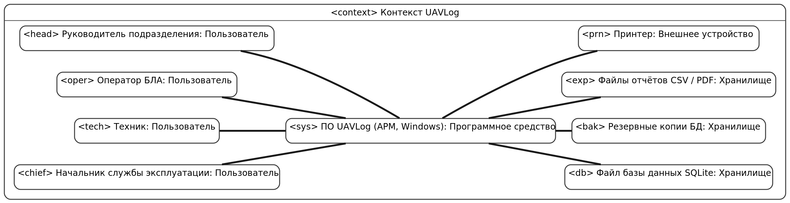

*Рисунок 1 — Системный контекст UAVLog (SysML v2, [models/01-context.sysml](models/01-context.sysml))*

### 1.3 Определения, акронимы и сокращения {#13-definitions-acronyms-and-abbreviations}

| Term | Definition |
|------|------------|
| АКБ | Аккумуляторная батарея БЛА; учитывается как отдельная единица с собственным счётчиком циклов |
| АРМ | Автоматизированное рабочее место — компьютер с установленным UAVLog |
| БЛА, борт | Беспилотный летательный аппарат, учитываемый в реестре под уникальным бортовым номером |
| Критичная неисправность | Неисправность, при которой полёты борта запрещены до её устранения |
| Налёт | Суммарная продолжительность полётов борта в часах и минутах |
| Наработка | Налёт и календарное время с момента последнего ТО данного вида |
| Оператор БЛА | Лицо, управляющее БЛА в полёте (внешний пилот) |
| Регламент ТО | Вид ТО для типа БЛА с периодичностью по налёту (ч) и/или календарю (дни) и перечнем работ |
| ТО | Техническое обслуживание |
| Формуляр | Документ с паспортными данными борта и историей его эксплуатации |
| Цикл АКБ | Один полёт с использованием АКБ (заряд-разряд) |
| CSV | Comma-Separated Values — текстовый табличный формат для обмена с Excel |
| GUI | Graphical User Interface — графический интерфейс пользователя |
| SQLite | Встраиваемая СУБД, хранящая базу данных в одном файле |
| SRS | Software Requirements Specification — спецификация требований к ПО |
| SysML v2 | Systems Modeling Language версии 2 — язык моделирования систем |

### 1.4 Ссылки {#14-references}

| Документ | Владелец, версия | Расположение | Статус |
|----------|------------------|--------------|--------|
| ISO/IEC/IEEE 29148:2018 Requirements engineering | ISO/IEC/IEEE, 2018 | iso.org | Справочный |
| OMG Systems Modeling Language (SysML) v2.0 | OMG, 2025 | omg.org/spec/SysML | Справочный |
| SysML v2 Pilot Implementation, ядро Jupyter | Systems-Modeling, 0.63.0 | github.com/Systems-Modeling/SysML-v2-Pilot-Implementation | Справочный |
| Модели SysML v2 к данному SRS | Осипенко О. С. | [srs/models](models/) | Нормативный |
| Правила работы с репозиторием | Кафедра ЭВМ | [CONTRIBUTING.md](../CONTRIBUTING.md) | Нормативный |
| Документация Qt 6 | The Qt Company, 6.11 | doc.qt.io | Справочный |
| Инструкция по эксплуатации БЛА и регламенты ТО Заказчика | Заказчик | Передаётся Заказчиком до этапа проектирования | Нормативный |

### 1.5 Обзор документа {#15-document-overview}

Раздел 2 описывает контекст, функции, ограничения и пользователей. Раздел 3 содержит требования с идентификаторами `REQ-[AREA]-[NNN]-[VER]`: суффикс версии (например, `-2`) добавляется к требованию, изменённому после рецензирования. Раздел 4 содержит матрицу верификации, раздел 5 — прототип GUI и протокол выявления требований. Изменения вносятся только через pull request и фиксируются в истории изменений.

---

## 2. Обзор продукта {#2-product-overview}

### 2.1 Перспектива продукта {#21-product-perspective}

UAVLog — новый самостоятельный продукт, разрабатываемый на протяжении курса «Жизненный цикл разработки ПО». Сейчас учёт ведётся в бумажных формулярах и таблицах Excel, из-за чего налёт пересчитывается вручную, а сроки ТО отслеживаются по памяти. UAVLog работает на одном АРМ службы эксплуатации без подключения к сети (рисунок 1): данные хранятся в локальном файле SQLite, отчёты выгружаются в файлы CSV и печатаются. Владелец продукта — начальник службы эксплуатации БЛА (Заказчик), сопровождение выполняет разработчик в рамках курса.

### 2.2 Функции продукта {#22-product-functions}

- Вход в систему с ролями пользователей.
- Ведение справочников: типы БЛА и регламенты ТО, борта, АКБ и полезная нагрузка, операторы.
- Регистрация полётов с автоматической проверкой допуска борта (рисунок 5).
- Автоматический расчёт налёта, наработки до ТО и циклов АКБ.
- Предупреждения о приближении ТО.
- Регистрация выполненного ТО и неисправностей, ведение состояния борта (рисунок 4).
- Формуляр борта, поиск по журналам, отчёты за период с экспортом в CSV.
- Резервное копирование и восстановление базы данных.

Варианты использования и их участники приведены на рисунке 2, бизнес-цели — на рисунке 3.

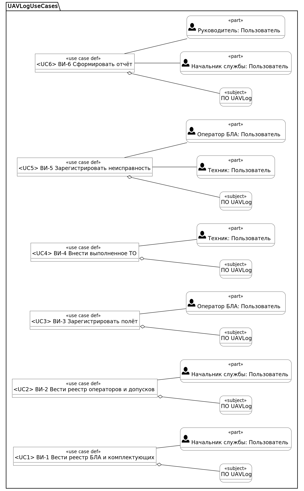

*Рисунок 2 — Варианты использования UAVLog ([models/02-usecases.sysml](models/02-usecases.sysml))*

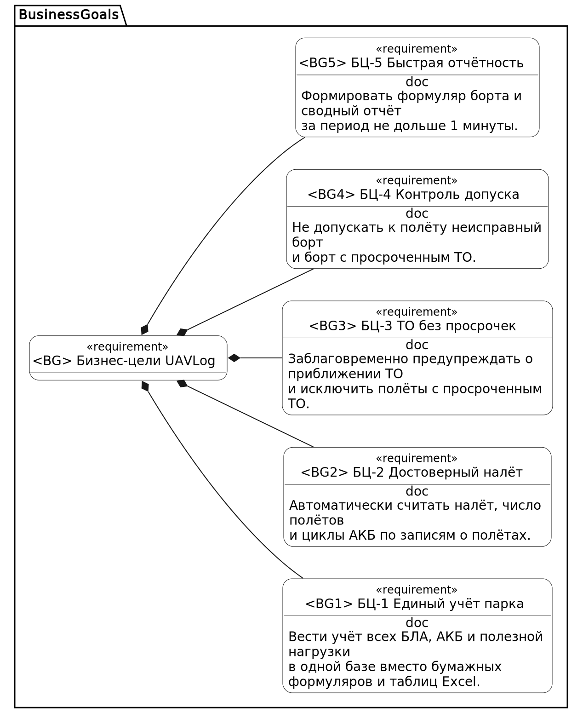

*Рисунок 3 — Бизнес-цели Заказчика ([models/03-business-goals.sysml](models/03-business-goals.sysml))*

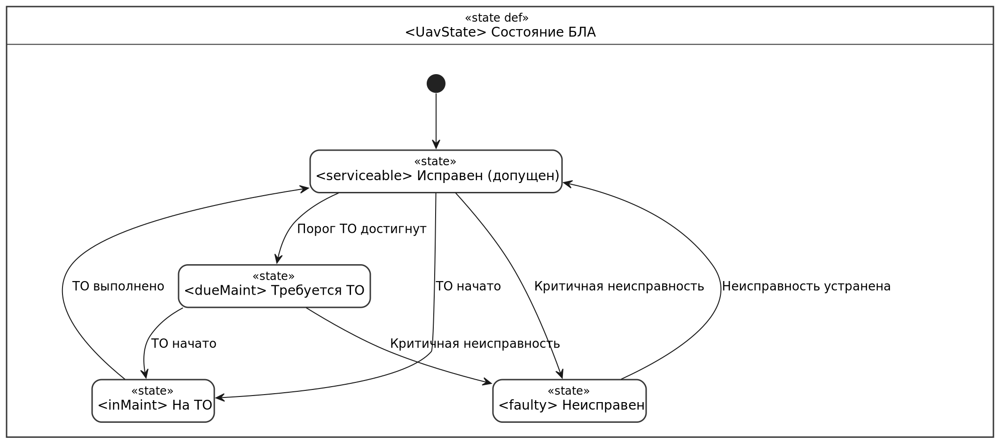

*Рисунок 4 — Жизненный цикл борта в реестре ([models/04-uav-states.sysml](models/04-uav-states.sysml))*

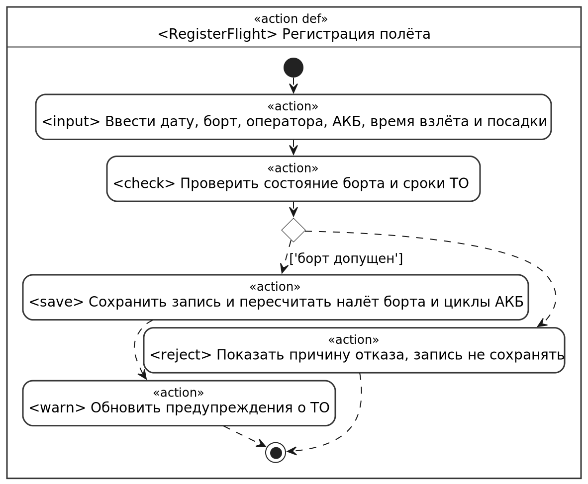

*Рисунок 5 — Сценарий регистрации полёта с проверкой допуска ([models/05-flight-registration.sysml](models/05-flight-registration.sysml))*

### 2.3 Ограничения продукта {#23-product-constraints}

| ID | Ограничение | Вид |
|----|-------------|-----|
| CON-1 | ПО должно работать на АРМ под Windows 10/11 x64 без подключения к локальной сети и Интернету | Внешнее, обязательное |
| CON-2 | ПО должно быть настольным приложением на C++17 и Qt 6 (Qt Widgets), сборка — CMake | Внутреннее, обязательное (стек курса) |
| CON-3 | Данные должны храниться в одном файле SQLite 3 на АРМ | Внутреннее, обязательное |
| CON-4 | Интерфейс и документация — на русском языке | Внешнее, обязательное |
| CON-5 | Допускается использовать только бесплатные компоненты с лицензиями, не требующими оплаты | Внешнее, обязательное |
| CON-6 | Версия 1.0 должна быть сдана до окончания осеннего семестра 2026/2027 учебного года | Внешнее, обязательное |

### 2.4 Характеристики пользователей {#24-user-characteristics}

| Роль | Кто | Частота работы | Задачи | Права |
|------|-----|----------------|--------|-------|
| Администратор | Начальник службы эксплуатации (Заказчик) | Ежедневно | Справочники, пользователи, отчёты, резервные копии | Все функции |
| Техник | Техник по ТО | Несколько раз в неделю | Регистрация ТО и неисправностей | Журналы ТО и неисправностей, просмотр остального |
| Оператор | Оператор БЛА | После каждого полёта | Регистрация полётов и замеченных неисправностей | Журнал полётов, регистрация неисправности, просмотр |
| Наблюдатель | Руководитель подразделения | Еженедельно | Просмотр состояния парка и отчётов | Только просмотр и отчёты |

Пользователи — уверенные пользователи Windows и Excel, специальной подготовки по ИТ не имеют. Работа может вестись в полевых условиях на ноутбуке, поэтому интерфейс должен быть пригоден для экрана 1366×768 и работы с клавиатуры.

### 2.5 Допущения и зависимости {#25-assumptions-and-dependencies}

| Допущение / зависимость | Последствие, если неверно |
|-------------------------|---------------------------|
| С АРМ одновременно работает один пользователь | Потребуется сетевая СУБД и разграничение доступа к записям — пересмотр CON-3 |
| Время взлёта и посадки оператор вносит вручную по полётному листу | Возможны ошибки налёта; для снижения риска введены проверки ввода (REQ-FUNC-006) |
| Один полёт расходует один цикл АКБ | Счётчик циклов будет неточен; потребуется ручная корректировка циклов |
| Регламенты ТО и образцы форм отчётов Заказчик передаст до начала проектирования | Задержка проектирования отчётов (REQ-COMP-001) |
| Парк — до 50 бортов, до 2 000 полётов в год | При большем объёме требуется повторная проверка REQ-PERF |

### 2.6 Распределение требований {#26-apportioning-of-requirements}

| Требования | Подсистема | Релиз |
|------------|------------|-------|
| REQ-FUNC-001, REQ-SEC-001…005 | Аутентификация и права | 1.0 |
| REQ-FUNC-002…005 | Справочники и реестры | 1.0 |
| REQ-FUNC-006…011 | Журналы и расчёт наработки | 1.0 |
| REQ-FUNC-012…014 | Формуляр, поиск, отчёты | 1.0 |
| REQ-FUNC-015, REQ-REL-001…003 | Хранение и резервирование | 1.0 |

---

## 3. Требования {#3-requirements}

Требования записаны по шаблону: ID, заголовок, формулировка, обоснование, критерии приёмки, метод верификации, дополнительная информация. Слово «должна» означает обязательное требование. Ссылки на ограничения — по таблице 2.3.

### 3.1 Внешние интерфейсы {#31-external-interfaces}

#### 3.1.1 Пользовательские интерфейсы {#311-user-interfaces}

Прототип интерфейса выполнен на SysML v2 (раздел 5.1): карта окон — рисунок 6, мокапы окон — рисунки 7–12.

- **ID:** REQ-INT-001
- **Title:** Язык и форматы
- **Statement:** Интерфейс должен быть на русском языке; даты должны отображаться и вводиться в формате ДД.ММ.ГГГГ, время — ЧЧ:ММ (24 часа), налёт — Ч:ММ.
- **Rationale:** Пользователи работают с бумажными формулярами в этих форматах (CON-4).
- **Acceptance Criteria:** Все надписи, сообщения и отчёты на русском языке; поля даты и времени не принимают значения в других форматах.
- **Verification Method:** Inspection
- **More Information:** —

- **ID:** REQ-INT-002
- **Title:** Состав и размещение окон
- **Statement:** Окна приложения должны соответствовать мокапам рисунков 7–12 по составу элементов, а переходы между ними — карте окон (рисунок 6).
- **Rationale:** Мокапы согласованы с Заказчиком и являются прототипом GUI.
- **Acceptance Criteria:** Каждый элемент мокапа присутствует в окне; главное окно полностью помещается на экран 1366×768 без горизонтальной прокрутки.
- **Verification Method:** Inspection
- **More Information:** [models/06-gui.sysml](models/06-gui.sysml)

- **ID:** REQ-INT-003
- **Title:** Индикация состояния
- **Statement:** Состояние борта и срок ТО должны обозначаться цветом (зелёный — допущен, жёлтый — приближается срок, красный — не допущен) и одновременно текстом.
- **Rationale:** Цвет ускоряет восприятие, текст нужен при печати в оттенках серого и для пользователей с нарушением цветовосприятия.
- **Acceptance Criteria:** Для каждого цвета в таблице парка выводится текстовая подпись; в отчётах используется только текст.
- **Verification Method:** Demonstration
- **More Information:** Пороги цветов — REQ-FUNC-009.

- **ID:** REQ-INT-004
- **Title:** Работа с клавиатуры
- **Statement:** Все операции ввода должны выполняться с клавиатуры: переход между полями — Tab в порядке, заданном на мокапах, Enter — сохранить, Esc — отменить, Ctrl+F — поиск в главном окне.
- **Rationale:** Записи после полётов вносятся быстро, часто на ноутбуке без мыши.
- **Acceptance Criteria:** Регистрация полёта выполняется без использования мыши.
- **Verification Method:** Demonstration
- **More Information:** Порядок обхода — связи `connect` в [models/06-gui.sysml](models/06-gui.sysml).

#### 3.1.2 Аппаратные интерфейсы {#312-hardware-interfaces}

UAVLog не взаимодействует с БЛА, наземными станциями управления и зарядными устройствами.

- **ID:** REQ-INT-005
- **Title:** Печать
- **Statement:** Приложение должно печатать формуляр и отчёты на любом принтере, установленном в Windows, на листах A4.
- **Rationale:** Формуляр и отчёты подписываются на бумаге.
- **Acceptance Criteria:** Печать формуляра с 50 полётами занимает целое число листов A4 без обрезанных столбцов.
- **Verification Method:** Test
- **More Information:** Используется стандартный диалог печати ОС.

#### 3.1.3 Программные интерфейсы {#313-software-interfaces}

- **ID:** REQ-INT-006
- **Title:** Хранение данных
- **Statement:** Все данные должны храниться в одном файле базы данных SQLite 3, путь к которому задаётся в настройках.
- **Rationale:** Простое резервное копирование и перенос копированием файла (CON-3).
- **Acceptance Criteria:** После копирования файла БД на другое АРМ приложение открывает те же данные.
- **Verification Method:** Test
- **More Information:** —

- **ID:** REQ-INT-007
- **Title:** Экспорт в CSV
- **Statement:** Таблицы журналов и отчётов должны экспортироваться в CSV: кодировка UTF-8 с BOM, разделитель «;», первая строка — заголовки столбцов.
- **Rationale:** Заказчик продолжает обработку данных в Excel.
- **Acceptance Criteria:** Экспортированный файл открывается двойным щелчком в Excel с корректной кириллицей и разбиением на столбцы.
- **Verification Method:** Test
- **More Information:** —

### 3.2 Функциональные требования {#32-functional}

- **ID:** REQ-FUNC-001
- **Title:** Вход в систему
- **Statement:** Система должна допускать к работе только пользователя, указавшего верные логин и пароль, и предоставлять ему функции согласно его роли (таблица 2.4).
- **Rationale:** Записи журнала являются отчётными данными, авторство изменений должно быть известно.
- **Acceptance Criteria:** При неверной паре логин/пароль выводится сообщение «Неверный логин или пароль», главное окно не открывается; после входа недоступные роли команды скрыты.
- **Verification Method:** Test
- **More Information:** Мокап — рисунок 7; защита — REQ-SEC-001…005.

- **ID:** REQ-FUNC-002
- **Title:** Типы БЛА и регламенты ТО
- **Statement:** Администратор должен иметь возможность вести справочник типов БЛА и для каждого типа — регламенты ТО: наименование вида ТО, периодичность по налёту (ч) и/или по календарю (дни), перечень работ.
- **Rationale:** Сроки ТО различаются для разных типов БЛА (БЦ-3).
- **Acceptance Criteria:** Для типа можно задать не менее 5 видов ТО; вид ТО без обеих периодичностей не сохраняется.
- **Verification Method:** Test
- **More Information:** —

- **ID:** REQ-FUNC-003
- **Title:** Реестр бортов
- **Statement:** Администратор должен иметь возможность добавлять, редактировать и удалять борта (бортовой номер, тип, заводской номер, дата ввода в эксплуатацию, примечание).
- **Rationale:** Единый реестр парка (БЦ-1).
- **Acceptance Criteria:** Бортовой номер уникален; при удалении борта запрашивается подтверждение.
- **Verification Method:** Test
- **More Information:** Состояния борта — рисунок 4.

- **ID:** REQ-FUNC-004
- **Title:** Реестр АКБ и полезной нагрузки
- **Statement:** Администратор должен иметь возможность вести реестр АКБ и полезной нагрузки (инвентарный номер, тип, дата ввода) и закреплять их за бортами.
- **Rationale:** АКБ и нагрузка переставляются между бортами, их учёт ведётся отдельно (БЦ-1).
- **Acceptance Criteria:** Единица может быть закреплена не более чем за одним бортом; история закреплений отображается в формуляре.
- **Verification Method:** Test
- **More Information:** —

- **ID:** REQ-FUNC-005
- **Title:** Реестр операторов
- **Statement:** Администратор должен иметь возможность вести реестр операторов: ФИО, должность, номер документа о допуске.
- **Rationale:** Каждый полёт связывается с выполнившим его оператором (БЦ-2).
- **Acceptance Criteria:** Оператор без ФИО не сохраняется; оператор отображается в списке выбора диалога регистрации полёта.
- **Verification Method:** Test
- **More Information:** —

- **ID:** REQ-FUNC-006
- **Title:** Регистрация полёта с проверкой допуска борта
- **Statement:** Система должна регистрировать полёт (дата, борт, оператор, АКБ, время взлёта и посадки, задача и район полётов, замечания) только если борт находится в состоянии «Исправен» и ни один вид ТО не просрочен.
- **Rationale:** Главная бизнес-цель — исключить полёты неисправных бортов (БЦ-4).
- **Acceptance Criteria:** Длительность рассчитывается автоматически; при времени посадки раньше взлёта или длительности более 12 ч запись не сохраняется; при нарушении условия кнопка «Сохранить» неактивна, индикатор допуска показывает причину отказа.
- **Verification Method:** Test
- **More Information:** Сценарий — рисунок 5, мокап — рисунок 10.

- **ID:** REQ-FUNC-007
- **Title:** Учёт наработки
- **Statement:** После сохранения, изменения или удаления записи о полёте система должна пересчитывать налёт и число полётов борта, наработку с последнего ТО каждого вида и число циклов АКБ.
- **Rationale:** Ручной пересчёт налёта — основной источник ошибок (БЦ-2).
- **Acceptance Criteria:** Налёт борта равен сумме длительностей его полётов с точностью до минуты; число циклов АКБ равно числу полётов с ней.
- **Verification Method:** Test
- **More Information:** —

- **ID:** REQ-FUNC-008
- **Title:** Расчёт остатка до ТО
- **Statement:** Для каждого борта и вида ТО система должна рассчитывать остаток до ТО в часах налёта и в днях; при достижении любого из сроков борт должен переходить в состояние «Требуется ТО».
- **Rationale:** ТО выполняется по тому сроку, который наступит раньше (БЦ-3).
- **Acceptance Criteria:** Остаток по налёту = периодичность − наработка; по календарю = дата последнего ТО + периодичность − текущая дата; столбец «До ТО» показывает меньший из остатков.
- **Verification Method:** Test
- **More Information:** Состояния — рисунок 4.

- **ID:** REQ-FUNC-009
- **Title:** Предупреждения о ТО
- **Statement:** Система должна заблаговременно предупреждать пользователя о приближении срока ТО и о просроченном ТО на панели предупреждений главного окна.
- **Rationale:** Пропуск сроков ТО — основная проблема Заказчика (БЦ-3).
- **Acceptance Criteria:** Двойной щелчок по предупреждению выделяет борт в таблице.
- **Verification Method:** Test
- **More Information:** —

- **ID:** REQ-FUNC-010
- **Title:** Регистрация выполненного ТО
- **Statement:** Техник должен иметь возможность зарегистрировать выполненное ТО (борт, вид ТО, дата, исполнитель, отметки по перечню работ, примечание); после сохранения наработка по этому виду ТО обнуляется.
- **Rationale:** Без записи о ТО невозможно рассчитать следующий срок (БЦ-3).
- **Acceptance Criteria:** Перечень работ заполняется из регламента выбранного вида ТО; ТО не сохраняется, пока не отмечены все работы или не указана причина невыполнения; наработка на момент ТО подставляется автоматически.
- **Verification Method:** Test
- **More Information:** Мокап — рисунок 11.

- **ID:** REQ-FUNC-011
- **Title:** Регистрация неисправностей
- **Statement:** Техник и оператор должны иметь возможность зарегистрировать неисправность (борт, дата, описание, признак критичности), техник — отметить её устранение; критичная неисправность переводит борт в состояние «Неисправен», устранение всех критичных — в «Исправен».
- **Rationale:** Неисправный борт не должен выпускаться в полёт (БЦ-4).
- **Acceptance Criteria:** Состояние борта меняется сразу после сохранения записи; устранение требует указания выполненных работ.
- **Verification Method:** Test
- **More Information:** Состояния — рисунок 4.

- **ID:** REQ-FUNC-012
- **Title:** Формуляр борта
- **Statement:** Система должна показывать формуляр борта: паспортные данные, состояние, налёт, остатки до ТО и вкладки с журналами полётов, ТО, неисправностей, АКБ и полезной нагрузки.
- **Rationale:** Формуляр заменяет бумажный документ (БЦ-1, БЦ-5).
- **Acceptance Criteria:** Формуляр открывается двойным щелчком по борту в главном окне; печать формуляра — REQ-INT-005.
- **Verification Method:** Demonstration
- **More Information:** Мокап — рисунок 9.

- **ID:** REQ-FUNC-013
- **Title:** Поиск и фильтрация
- **Statement:** В главном окне и журналах система должна фильтровать записи по бортовому номеру, оператору, типу БЛА, состоянию и периоду дат.
- **Rationale:** Заказчику нужно быстро находить записи по конкретному борту или оператору.
- **Acceptance Criteria:** Фильтр применяется при вводе без нажатия дополнительных кнопок; время отклика — REQ-PERF-002.
- **Verification Method:** Test
- **More Information:** —

- **ID:** REQ-FUNC-014
- **Title:** Отчёты
- **Statement:** Система должна формировать за выбранный период отчёты «Налёт по бортам», «Налёт по операторам», «Неисправности», «Выполнение ТО», показывать их в окне предварительного просмотра, экспортировать в CSV и печатать.
- **Rationale:** Отчёты подаются руководителю (БЦ-5).
- **Acceptance Criteria:** Итоговые суммы налёта совпадают с данными журналов.
- **Verification Method:** Test
- **More Information:** Мокап — рисунок 12.

- **ID:** REQ-FUNC-015
- **Title:** Резервное копирование
- **Statement:** Администратор должен иметь возможность создать резервную копию БД в выбранный каталог и восстановить БД из копии.
- **Rationale:** Файл БД — единственное хранилище данных (CON-3).
- **Acceptance Criteria:** Перед восстановлением текущая БД автоматически сохраняется в копию; после восстановления данные соответствуют копии.
- **Verification Method:** Test
- **More Information:** Автоматическое резервирование — REQ-REL-002.

### 3.3 Качество обслуживания {#33-quality-of-service}

Все показатели производительности измеряются на эталонном АРМ: процессор Intel Core i3 10-го поколения, 8 ГБ ОЗУ, SSD, Windows 10 x64; эталонная БД — 50 бортов, 20 000 полётов (10 лет эксплуатации).

#### 3.3.1 Производительность {#331-performance}

- **ID:** REQ-PERF-001
- **Title:** Время запуска
- **Statement:** Главное окно с заполненной таблицей парка и панелью предупреждений должно открываться не более чем за 5 с после входа в систему.
- **Rationale:** Записи вносятся сразу после полётов.
- **Acceptance Criteria:** Медиана 10 замеров на эталонной БД ≤ 5 с.
- **Verification Method:** Test
- **More Information:** —

- **ID:** REQ-PERF-002
- **Title:** Отклик фильтрации
- **Statement:** Результат фильтрации журнала полётов должен отображаться не более чем через 1 с после ввода условия.
- **Rationale:** REQ-FUNC-013.
- **Acceptance Criteria:** 95 % замеров на эталонной БД ≤ 1 с.
- **Verification Method:** Test
- **More Information:** —

- **ID:** REQ-PERF-003
- **Title:** Формирование отчётов
- **Statement:** Отчёт за календарный год должен формироваться не более чем за 10 с.
- **Rationale:** БЦ-5 — отчётность не дольше 1 минуты вместе с настройкой параметров.
- **Acceptance Criteria:** Замеры на эталонной БД для каждого вида отчёта.
- **Verification Method:** Test
- **More Information:** —

- **ID:** REQ-PERF-004
- **Title:** Потребление памяти
- **Statement:** Приложение должно использовать не более 300 МБ оперативной памяти при работе с эталонной БД.
- **Rationale:** АРМ в полевых условиях — ноутбук с ограниченными ресурсами.
- **Acceptance Criteria:** Пиковый объём рабочего набора процесса по диспетчеру задач ≤ 300 МБ при формировании годового отчёта.
- **Verification Method:** Test
- **More Information:** —

#### 3.3.2 Безопасность {#332-security}

- **ID:** REQ-SEC-001
- **Title:** Хранение паролей
- **Statement:** Пароли должны храниться только в виде хеша PBKDF2-HMAC-SHA256 с индивидуальной солью и не менее 100 000 итераций; минимальная длина пароля — 8 символов.
- **Rationale:** Файл БД может быть скопирован вместе с резервной копией.
- **Acceptance Criteria:** В файле БД отсутствуют пароли в открытом виде; пароль короче 8 символов не принимается.
- **Verification Method:** Inspection
- **More Information:** —

- **ID:** REQ-SEC-002
- **Title:** Разграничение прав
- **Statement:** Система должна предоставлять функции строго по матрице прав ролей (таблица 2.4) и проверять права при каждом изменении данных.
- **Rationale:** Например, оператор не должен отмечать выполнение ТО.
- **Acceptance Criteria:** Для каждой роли проверены все команды меню и панели инструментов: недоступные скрыты, попытка изменения в обход GUI отклоняется.
- **Verification Method:** Test
- **More Information:** —

- **ID:** REQ-SEC-003
- **Title:** Блокировка сеанса
- **Statement:** После 15 минут бездействия сеанс должен блокироваться до повторного ввода пароля.
- **Rationale:** АРМ может остаться без присмотра.
- **Acceptance Criteria:** Через 15 мин без ввода открывается окно входа, несохранённые данные диалогов не теряются.
- **Verification Method:** Test
- **More Information:** —

- **ID:** REQ-SEC-004
- **Title:** Журнал аудита
- **Statement:** Система должна записывать в журнал аудита каждое создание, изменение и удаление записей: пользователь, дата и время, объект, старое и новое значение.
- **Rationale:** Изменения отчётных данных должны быть прослеживаемы.
- **Acceptance Criteria:** Журнал доступен администратору только для просмотра и выгрузки; средствами GUI его изменить нельзя.
- **Verification Method:** Test
- **More Information:** —

- **ID:** REQ-SEC-005
- **Title:** Защита от подбора пароля
- **Statement:** После 5 неудачных попыток входа подряд учётная запись должна блокироваться на 5 минут.
- **Rationale:** Защита от подбора пароля на оставленном АРМ.
- **Acceptance Criteria:** Шестая попытка в течение 5 мин отклоняется даже с верным паролем.
- **Verification Method:** Test
- **More Information:** —

#### 3.3.3 Надёжность {#333-reliability}

- **ID:** REQ-REL-001
- **Title:** Целостность при сбое
- **Statement:** Каждая операция сохранения должна выполняться атомарно: при аварийном завершении приложения или отключении питания сохраняются все подтверждённые операции и ни одна частично выполненная.
- **Rationale:** Пересчёт наработки затрагивает несколько записей (REQ-FUNC-007).
- **Acceptance Criteria:** В тесте с принудительным завершением процесса во время 100 сохранений БД остаётся согласованной: налёт равен сумме полётов.
- **Verification Method:** Test
- **More Information:** —

- **ID:** REQ-REL-002
- **Title:** Автоматическое резервирование
- **Statement:** При выходе из приложения должна автоматически создаваться резервная копия БД, если с предыдущей прошло более 24 часов; хранятся 30 последних копий.
- **Rationale:** Пользователи забывают делать копии вручную.
- **Acceptance Criteria:** Число копий в каталоге не превышает 30, самые старые удаляются.
- **Verification Method:** Test
- **More Information:** —

- **ID:** REQ-REL-003
- **Title:** Проверка БД при запуске
- **Statement:** При запуске система должна проверять целостность файла БД и при повреждении предлагать восстановление из последней резервной копии.
- **Rationale:** Файл может повредиться при сбое накопителя.
- **Acceptance Criteria:** На заведомо повреждённом файле выводится сообщение и предложение восстановления, приложение не завершается аварийно.
- **Verification Method:** Test
- **More Information:** —

#### 3.3.4 Доступность {#334-availability}

- **ID:** REQ-AVAIL-001
- **Title:** Автономная работа
- **Statement:** Все функции должны быть доступны без подключения к сети.
- **Rationale:** АРМ используется в полевых условиях и в изолированной сети (CON-1).
- **Acceptance Criteria:** Все тест-кейсы раздела 4 проходят при отключённых сетевых адаптерах.
- **Verification Method:** Test
- **More Information:** —

#### 3.3.5 Наблюдаемость {#335-observability}

- **ID:** REQ-OBS-001
- **Title:** Журнал ошибок
- **Statement:** Приложение должно записывать ошибки и предупреждения в текстовый файл журнала с датой, временем, уровнем и описанием; размер файла — не более 10 МБ с ротацией до 5 файлов.
- **Rationale:** Разработчик анализирует сбои по журналу, присланному Заказчиком.
- **Acceptance Criteria:** Ошибка открытия БД фиксируется в журнале; при превышении 10 МБ создаётся новый файл.
- **Verification Method:** Test
- **More Information:** —

### 3.4 Соответствие стандартам {#34-compliance}

- **ID:** REQ-COMP-001
- **Title:** Формы документов
- **Statement:** Печатные формы формуляра и отчётов должны соответствовать образцам, утверждённым Заказчиком.
- **Rationale:** Документы подшиваются в дела подразделения.
- **Acceptance Criteria:** Заказчик подписывает акт сверки форм.
- **Verification Method:** Inspection
- **More Information:** Открытый вопрос: образцы форм будут переданы Заказчиком до этапа проектирования.

- **ID:** REQ-COMP-002
- **Title:** Лицензии компонентов
- **Statement:** Все сторонние компоненты должны распространяться по лицензиям, допускающим бесплатное использование в составе UAVLog (CON-5).
- **Rationale:** Бюджет на лицензии отсутствует.
- **Acceptance Criteria:** Перечень компонентов с лицензиями приложен к поставке; Qt используется по LGPL v3 с динамической компоновкой.
- **Verification Method:** Inspection
- **More Information:** —

### 3.5 Проектирование и реализация {#35-design-and-implementation}

#### 3.5.1 Установка {#351-installation}

- **ID:** REQ-INST-001
- **Title:** Установка без прав администратора
- **Statement:** Установка должна выполняться распаковкой архива в любой каталог без прав администратора, первый запуск — создавать пустую БД и учётную запись администратора.
- **Rationale:** На АРМ подразделения у пользователей нет прав администратора.
- **Acceptance Criteria:** Установка и первый вход занимают не более 5 минут под обычной учётной записью Windows.
- **Verification Method:** Demonstration
- **More Information:** —

#### 3.5.2 Сборка и поставка {#352-build-and-delivery}

- **ID:** REQ-BUILD-001
- **Title:** Воспроизводимая сборка
- **Statement:** Сборка должна выполняться одной командой из репозитория с помощью CMake 3.21+, Qt 6.11 и MinGW 64-bit.
- **Rationale:** Проверка преподавателем и сопровождение (CON-2).
- **Acceptance Criteria:** На чистом клоне репозитория команда сборки завершается без ошибок, порядок описан в README.md.
- **Verification Method:** Demonstration
- **More Information:** —

#### 3.5.3 Распределение {#353-distribution}

- **ID:** REQ-DIST-001
- **Title:** Комплект поставки
- **Statement:** Поставка должна представлять собой ZIP-архив с исполняемым файлом, необходимыми библиотеками Qt, руководством пользователя в PDF и перечнем лицензий.
- **Rationale:** Перенос на АРМ без Интернета на съёмном носителе.
- **Acceptance Criteria:** Приложение запускается из распакованного архива на чистой Windows 10 без установки дополнительных компонентов.
- **Verification Method:** Test
- **More Information:** —

#### 3.5.4 Сопровождаемость {#354-maintainability}

- **ID:** REQ-MAINT-001
- **Title:** Архитектура и тесты
- **Statement:** Логика расчёта наработки, сроков ТО и допуска должна быть отделена от GUI (паттерн MVC) и покрыта модульными тестами не менее чем на 80 % строк.
- **Rationale:** Это наиболее ответственная часть, которая будет меняться вместе с регламентами.
- **Acceptance Criteria:** Отчёт о покрытии модели ≥ 80 %; классы модели не зависят от модуля Qt Widgets.
- **Verification Method:** Analysis
- **More Information:** —

#### 3.5.5 Повторное использование {#355-reusability}

- **ID:** REQ-REUSE-001
- **Title:** Регламенты как данные
- **Statement:** Регламенты ТО, пороги предупреждений и типы БЛА должны задаваться данными в справочниках, а не в исходном коде.
- **Rationale:** Приложение должно подходить для других типов БЛА без доработки.
- **Acceptance Criteria:** Добавление нового типа БЛА с регламентами не требует пересборки.
- **Verification Method:** Demonstration
- **More Information:** —

#### 3.5.6 Переносимость {#356-portability}

- **ID:** REQ-PORT-001
- **Title:** Платформа
- **Statement:** Приложение должно работать в Windows 10 и Windows 11 x64; исходный код не должен использовать платформенно-зависимые API, кроме предоставляемых Qt.
- **Rationale:** CON-1; возможность сборки под Linux в будущем.
- **Acceptance Criteria:** Тесты раздела 4 проходят в обеих версиях Windows.
- **Verification Method:** Test
- **More Information:** Сборка под Linux не проверяется в версии 1.0.

#### 3.5.7 Стоимость {#357-cost}

- **ID:** REQ-COST-001
- **Title:** Бесплатные инструменты
- **Statement:** Разработка и эксплуатация не должны требовать покупки лицензий.
- **Rationale:** Учебный проект без бюджета (CON-5).
- **Acceptance Criteria:** Все инструменты и компоненты бесплатны — проверяется по перечню REQ-COMP-002.
- **Verification Method:** Inspection
- **More Information:** —

#### 3.5.8 Сроки {#358-deadline}

- **ID:** REQ-DEAD-001
- **Title:** Этапы
- **Statement:** Работы должны выполняться по этапам курса: SRS — лабораторная работа №3, проектирование (SDD) и реализация — последующие лабораторные работы, сдача версии 1.0 — до окончания осеннего семестра 2026/2027 учебного года (CON-6).
- **Rationale:** График лабораторных работ.
- **Acceptance Criteria:** Каждый этап завершается слиянием pull request в main.
- **Verification Method:** Inspection
- **More Information:** —

#### 3.5.9 Доказательство концепции {#359-proof-of-concept}

- **ID:** REQ-POC-001
- **Title:** Прототип GUI
- **Statement:** До начала проектирования прототип GUI в виде моделей SysML v2 (рисунки 6–12) должен быть согласован с Заказчиком.
- **Rationale:** Мокапы позволяют выявить ошибки в требованиях до написания кода.
- **Acceptance Criteria:** Pull request с моделями одобрен напарником (Заказчиком) и преподавателем.
- **Verification Method:** Inspection
- **More Information:** —

#### 3.5.10 Управление изменениями {#3510-change-management}

- **ID:** REQ-CM-001
- **Title:** Изменение требований
- **Statement:** Требования должны изменяться только через pull request в репозитории с рецензированием; изменённое требование получает следующий суффикс версии, изменение фиксируется в истории изменений.
- **Rationale:** Заказчик (в том числе преподаватель) может запросить изменения на любом этапе.
- **Acceptance Criteria:** Для каждой версии документа в истории изменений есть запись и соответствующий pull request.
- **Verification Method:** Inspection
- **More Information:** —

### 3.6 ИИ/МО {#36-aiml}

Не применимо: UAVLog не содержит компонентов искусственного интеллекта и машинного обучения.

---

## 4. Верификация {#4-verification}

Тесты выполняются вручную по тест-кейсам и автоматически (модульные тесты модели) на эталонном АРМ и эталонной БД (раздел 3.3). Тестовые данные — сгенерированная БД с 50 бортами и 20 000 полётов, включающая граничные случаи: просроченное ТО, критичная неисправность.

| Requirement ID | Verification Method | Test/Artifact Link | Status | Evidence |
|----------------|---------------------|--------------------|--------|----------|
| REQ-INT-001 | Inspection | tests/ui-checklist.md | Запланировано | |
| REQ-INT-002 | Inspection | images/06…12, tests/ui-checklist.md | Запланировано | |
| REQ-INT-003 | Demonstration | tests/TC-INT-003.md | Запланировано | |
| REQ-INT-004 | Demonstration | tests/TC-INT-004.md | Запланировано | |
| REQ-INT-005 | Test | tests/TC-INT-005.md | Запланировано | |
| REQ-INT-006 | Test | tests/TC-INT-006.md | Запланировано | |
| REQ-INT-007 | Test | tests/TC-INT-007.md | Запланировано | |
| REQ-FUNC-001 | Test | tests/TC-FUNC-001.md | Запланировано | |
| REQ-FUNC-002 | Test | tests/TC-FUNC-002.md | Запланировано | |
| REQ-FUNC-003 | Test | tests/TC-FUNC-003.md | Запланировано | |
| REQ-FUNC-004 | Test | tests/TC-FUNC-004.md | Запланировано | |
| REQ-FUNC-005 | Test | tests/TC-FUNC-005.md | Запланировано | |
| REQ-FUNC-006 | Test | tests/TC-FUNC-006.md, модульные тесты допуска | Запланировано | |
| REQ-FUNC-007 | Test | модульные тесты наработки | Запланировано | |
| REQ-FUNC-008 | Test | модульные тесты сроков ТО | Запланировано | |
| REQ-FUNC-009 | Test | tests/TC-FUNC-009.md | Запланировано | |
| REQ-FUNC-010 | Test | tests/TC-FUNC-010.md | Запланировано | |
| REQ-FUNC-011 | Test | tests/TC-FUNC-011.md | Запланировано | |
| REQ-FUNC-012 | Demonstration | tests/TC-FUNC-012.md | Запланировано | |
| REQ-FUNC-013 | Test | tests/TC-FUNC-013.md | Запланировано | |
| REQ-FUNC-014 | Test | tests/TC-FUNC-014.md | Запланировано | |
| REQ-FUNC-015 | Test | tests/TC-FUNC-015.md | Запланировано | |
| REQ-PERF-001…004 | Test | tests/perf.md | Запланировано | |
| REQ-SEC-001 | Inspection | обзор кода и файла БД | Запланировано | |
| REQ-SEC-002…005 | Test | tests/TC-SEC.md | Запланировано | |
| REQ-REL-001…003 | Test | tests/TC-REL.md | Запланировано | |
| REQ-AVAIL-001 | Test | прогон тестов без сети | Запланировано | |
| REQ-OBS-001 | Test | tests/TC-OBS-001.md | Запланировано | |
| REQ-COMP-001, REQ-COMP-002 | Inspection | акт сверки форм, перечень лицензий | Запланировано | |
| REQ-INST-001, REQ-BUILD-001, REQ-DIST-001 | Demonstration, Test | README.md, чистая ВМ Windows 10 | Запланировано | |
| REQ-MAINT-001 | Analysis | отчёт о покрытии | Запланировано | |
| REQ-REUSE-001, REQ-PORT-001 | Demonstration, Test | tests/TC-PORT.md | Запланировано | |
| REQ-COST-001, REQ-DEAD-001, REQ-POC-001, REQ-CM-001 | Inspection | история pull request | Запланировано | |

---

## 5. Приложения {#5-appendixes}

### 5.1 Прототип GUI на SysML v2

Прототип описан в [models/06-gui.sysml](models/06-gui.sysml): пакет `GuiLib` задаёт типовые элементы интерфейса (окно, панель, поле ввода, таблица и т. д.), пакет `GuiMockups` — состав каждого окна, пакет `GuiNavigation` — переходы между окнами. Вложенность частей (part) соответствует вложенности элементов окна. Нетипизированные связи `connect` задают порядок обхода полей клавишей Tab, типизированные (`connection : …`) — передачу данных между элементами. Изображения получены командой `%viz` ядра SysML v2 Pilot Implementation (скрипт [models/render.py](models/render.py), образ [models/Dockerfile](models/Dockerfile)).

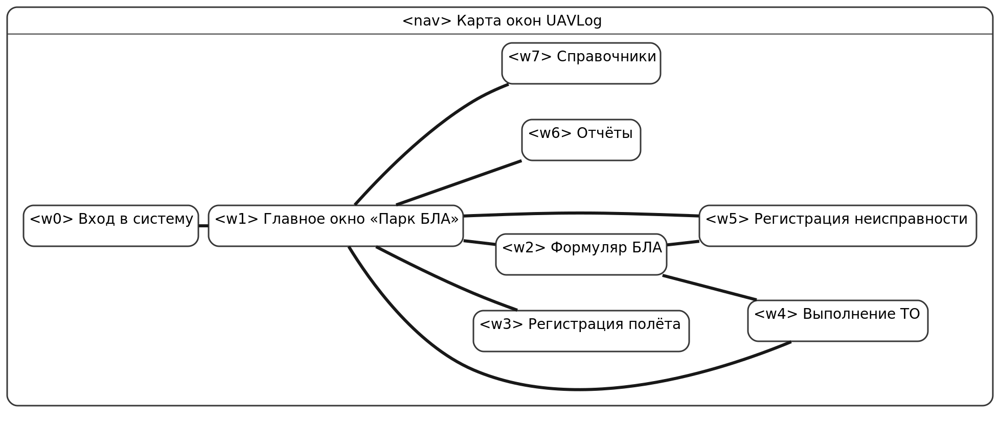

*Рисунок 6 — Карта окон*

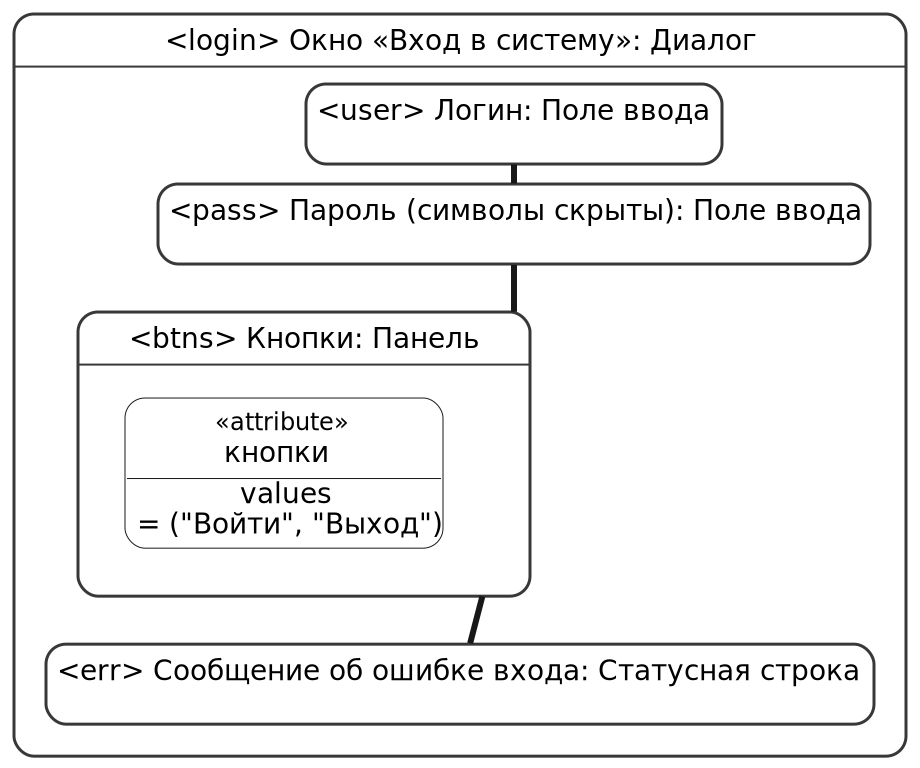

*Рисунок 7 — Окно «Вход в систему»*

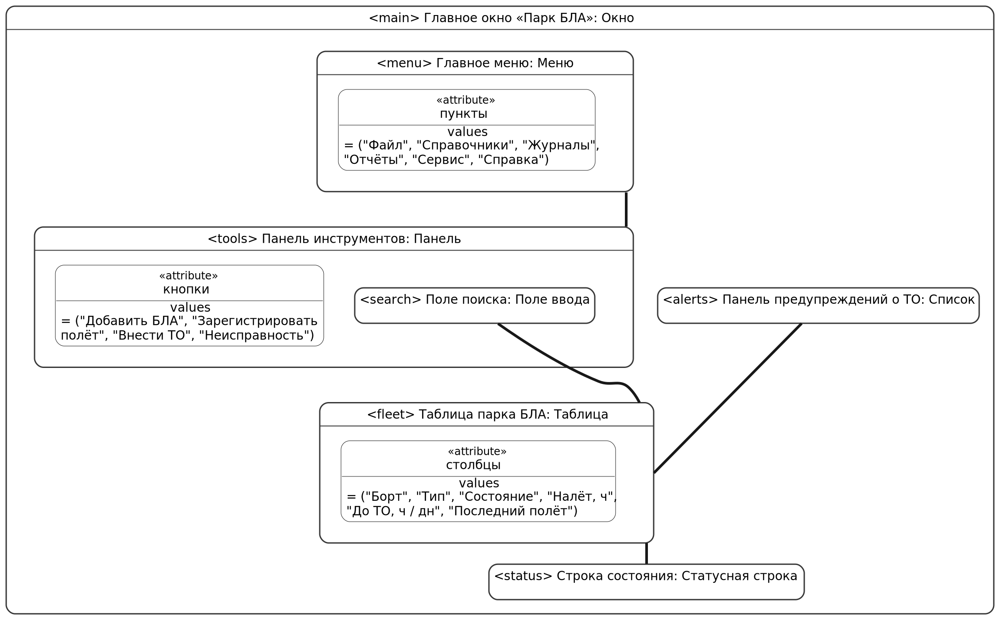

*Рисунок 8 — Главное окно «Парк БЛА»*

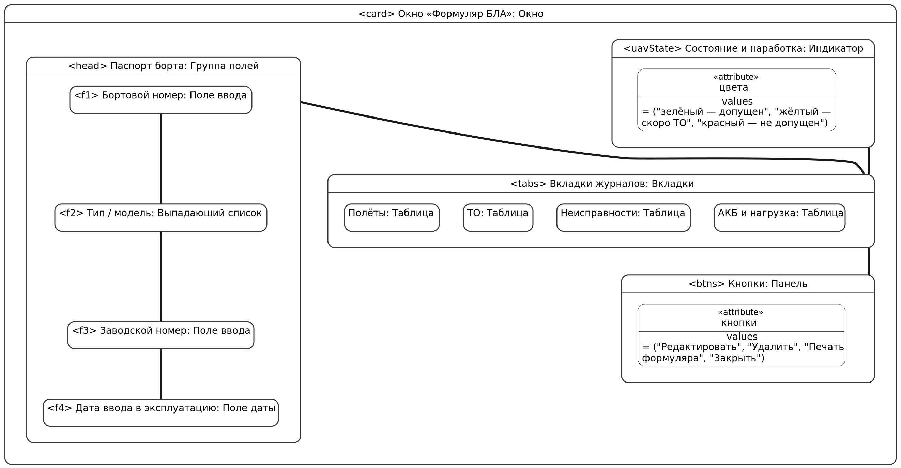

*Рисунок 9 — Окно «Формуляр БЛА»*

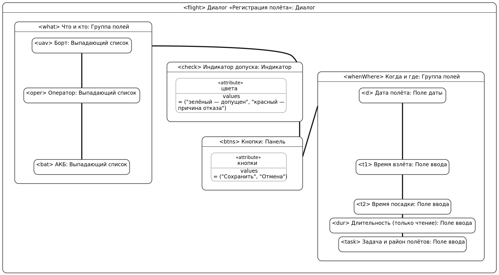

*Рисунок 10 — Диалог «Регистрация полёта»*

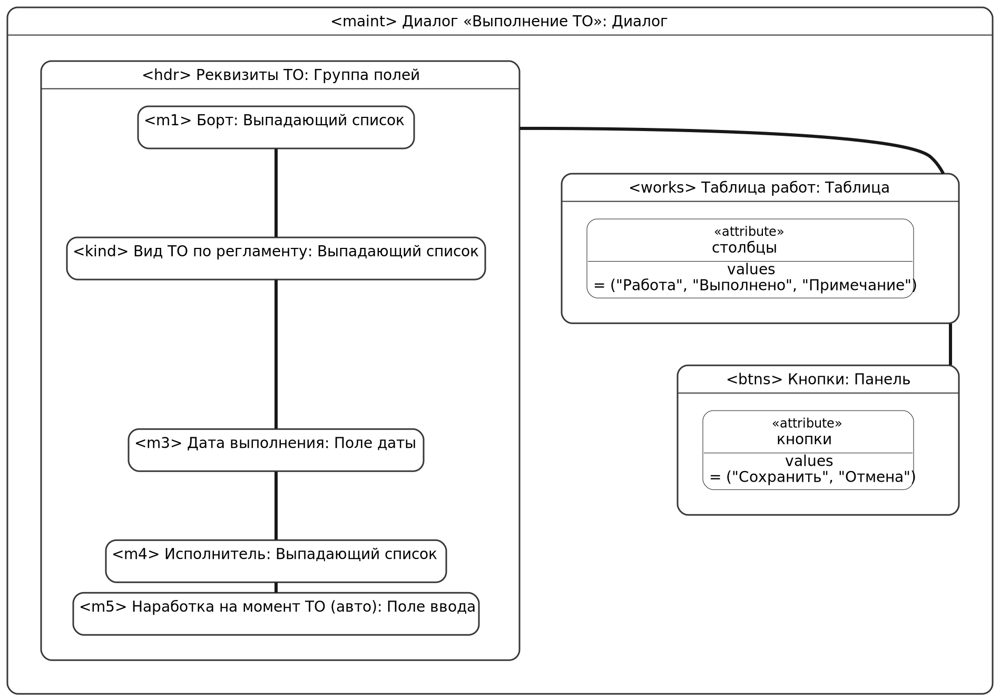

*Рисунок 11 — Диалог «Выполнение ТО»*

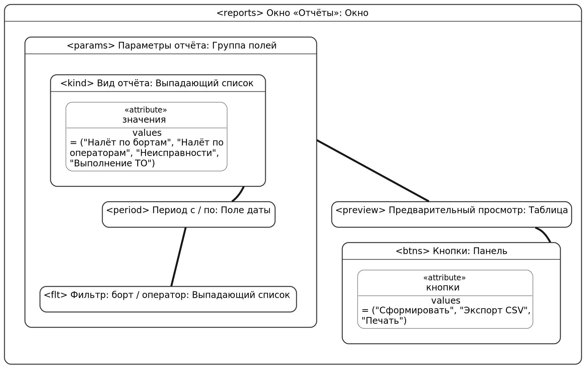

*Рисунок 12 — Окно «Отчёты»*

### 5.2 Протокол выявления требований

Интервью проведено в форме ролевой игры: Заказчик — начальник службы эксплуатации БЛА (роль исполнял напарник Мороз А. А.), Менеджер проекта — автор документа.

| № | Вопрос Менеджера | Ответ Заказчика | Результат |
|---|------------------|-----------------|-----------|
| 1 | Какую проблему должно решить ПО? | Формуляры ведутся на бумаге и в Excel, налёт считают вручную, сроки ТО пропускают | БЦ-1, БЦ-2, БЦ-3 |
| 2 | Кто будет работать с программой? | Я, техники, операторы; руководитель смотрит отчёты | Роли (таблица 2.4) |
| 3 | Что учитывается кроме самих бортов? | АКБ и полезная нагрузка, они переставляются между бортами | REQ-FUNC-004 |
| 4 | Как определяется срок ТО? | По налёту или по календарю, что наступит раньше; для каждого типа свои регламенты | REQ-FUNC-002, REQ-FUNC-008 |
| 5 | Что должно происходить, если ТО просрочено или борт неисправен? | Такой борт нельзя выпускать в полёт | БЦ-4, REQ-FUNC-006, состояния (рисунок 4) |
| 6 | Есть ли на АРМ сеть? | Нет, АРМ автономный, часто ноутбук в поле | CON-1, REQ-AVAIL-001 |
| 7 | Какие отчёты нужны? | Налёт по бортам и операторам, отказы, выполнение ТО за период; должны открываться в Excel | REQ-FUNC-014, REQ-INT-007 |
| 8 | Сколько времени допустимо тратить на отчёт? | Не больше минуты | БЦ-5, REQ-PERF-003 |
| 9 | Кто вносит записи и как быстро? | Оператор сразу после полёта, у него мало времени | REQ-INT-004, REQ-PERF-001 |
| 10 | Нужно ли защищать данные? | Да, у каждого свой вход, правки должны быть видны | REQ-FUNC-001, REQ-SEC-001…005 |
